<div align="center">

# tmux-reorder-revamped

<strong>tmux のステータスバーでウィンドウのタブをマウスでドラッグして、そのウィンドウを移動します。</strong>

[English](README.md) &nbsp;|&nbsp; 日本語 &nbsp;|&nbsp; [简体中文](README.zh-Hans.md) &nbsp;|&nbsp; [繁體中文（香港）](README.zh-HK.md)

[](https://github.com/tmux-revamped/tmux-reorder-revamped/actions/workflows/ci.yml)
[](https://github.com/tmux-revamped/tmux-reorder-revamped/releases/latest)
[](https://scorecard.dev/viewer/?uri=github.com/tmux-revamped/tmux-reorder-revamped)
[](LICENSE)

<p align="center">
  <a href="#クイックスタート"><strong>クイックスタート</strong></a> &nbsp;|&nbsp;
  <a href="#使い方">使い方</a> &nbsp;|&nbsp;
  <a href="#仕組み">仕組み</a> &nbsp;|&nbsp;
  <a href="#画面">画面</a>
</p>

</div>

<p align="center">
  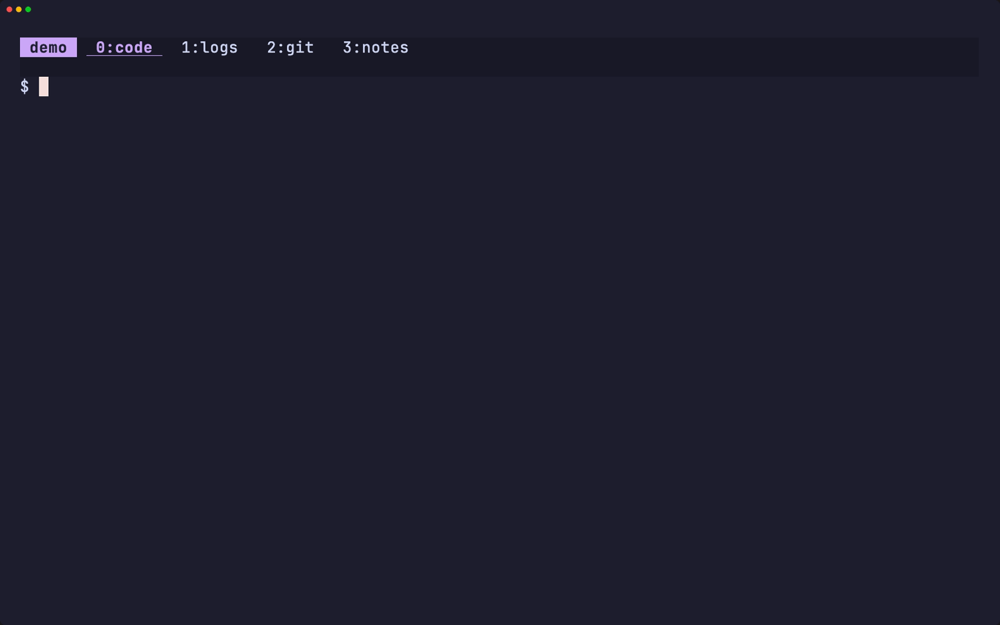
</p>

```console
$ reorder-revamped list | cut -c1-72
set-option -g @reorder_revamped_hit #{window_id}
set-option -g @reorder_revamped_press_original switch-client -t =
bind-key -n MouseDown1Status set-option -gF -t = @reorder_revamped_press
bind-key -n SecondClick1Status set-option -gF -t = @reorder_revamped_pre
bind-key -n TripleClick1Status set-option -gF -t = @reorder_revamped_pre
bind-key -n MouseUp1Status set-option -gu @reorder_revamped_pressed \; s
bind-key -n MouseDrag1Status if-shell -F #{&&:#{@reorder_revamped_presse
bind-key -n MouseDragEnd1Status run-shell -b -t = '/home/user/.tmux/plug
bind-key -n MouseDragEnd1StatusLeft run-shell -b '/home/user/.tmux/plugi
bind-key -n MouseDragEnd1StatusRight run-shell -b '/home/user/.tmux/plug
bind-key -n MouseDragEnd1StatusDefault run-shell -b '/home/user/.tmux/pl
```

タブを押してステータスバーに沿ってドラッグし、離すと、ウィンドウがそこへ移動し、間のタブがずれます。ドラッグ中はタブがポインターの下を滑り、セッション名か右端に落とすとウィンドウが先頭か末尾へ移動します。タブを押すと、これまでどおりそのウィンドウが選ばれます。

---

## クイックスタート

### 前提条件

| ツール | バージョン | 用途 |
|:-----|:--------|:---------|
| tmux | 3.2 以降 | ドラッグとドロップ。3.8 以降ではライブスライドのためにタブの幅を測ります |
| gum | 任意 | `reorder-revamped` のメニュー、表、色。なくてもすべてのコマンドがプレーンテキストで動きます |

### インストール

```tmux
set -g @plugin 'tmux-revamped/tmux-reorder-revamped'
set -g mouse on
```

続けて `prefix + I` を押します。TPM を使わない場合は、リポジトリをクローンし、`~/.tmux.conf` からエントリーポイントを実行します。

```bash
git clone https://github.com/tmux-revamped/tmux-reorder-revamped ~/.tmux/plugins/tmux-reorder-revamped
```

```tmux
run-shell ~/.tmux/plugins/tmux-reorder-revamped/reorder-revamped.tmux
```

クローンで `make install` を実行すると、`reorder-revamped` が `~/.local/bin` に、manページと補完が `~/.local/share` の下に入ります。

### 確認

```bash
~/.tmux/plugins/tmux-reorder-revamped/bin/reorder-revamped doctor
```

## 使い方

tmux の `mouse` オプションをオンにしてタブをドラッグします。マウス操作にはプレフィックスがないため、すべての割り当てはルートテーブルにあり、プラグインはプレフィックスキーを割り当てません。

| マウス | 動作 |
|:------|:-------|
| タブを押す | タブを記録し、それまでの押下コマンド（既定は `switch-client -t =`）を実行します |
| タブをドラッグする | ポインターが別のタブに入るたびに、ウィンドウをポインターの下へ滑らせます |
| タブの上で離す | ウィンドウをそのタブへ移動します |
| セッション名の上で離す | edges がオンのとき、ウィンドウを先頭へ移動します |
| 右端で離す | edges がオンのとき、ウィンドウを末尾へ移動します |
| 空いた場所で離す | edges がオンで、ウィンドウ一覧が左寄せのとき、ウィンドウを末尾へ移動します |

| コマンド | 動作 |
|:--------|:-------------|
| `reorder-revamped apply` | マウスの割り当てを今すぐ行います。プラグインの読み込み時にエントリーポイントが実行します |
| `reorder-revamped list` | apply が行う割り当てをすべて表示します。`--json` で 1 つのオブジェクトを出力します |
| `reorder-revamped grab`, `slide`, `drop`, `edge` | マウスの割り当てから実行されます。タブの測定、スライド、タブへのドロップ、端へのドロップ |
| `reorder-revamped doctor` | 依存関係ごとに 1 行 |
| `reorder-revamped version` | バージョンと tmux のバージョン |
| `reorder-revamped help` | ヘルプ。`man reorder-revamped` にも同じコマンドと設定があります |
| `reorder-revamped` | 端末ではメニュー |

| tmux オプション | 既定値 | 意味 |
|:------------|:--------|:--------|
| `@reorder_revamped_mode` | `insert` | `insert` はウィンドウを移動して間のウィンドウをずらします。`swap` は離したときに 2 つのウィンドウだけを入れ替え、ライブスライドはありません |
| `@reorder_revamped_live` | `on` | `off` でドラッグ中はタブを動かさず、離したときだけウィンドウを移動します |
| `@reorder_revamped_edges` | `on` | `off` でセッション名、右端、空いた場所を割り当てません |
| `@reorder_revamped_timeout` | `10` | 記録したドラッグを無視するまでのクライアント操作の秒数。ペインの上で放棄したドラッグが、後で離したときにウィンドウを動かさないようにします |
| `@reorder_revamped_enable_logging` | 未設定 | `1` で失敗した移動を `~/.tmux/reorder-revamped-logs/` に書き出します |

mode、live、edges は割り当ての形を決めるので、変更したら `reorder-revamped apply` を実行するか設定を再読み込みします。どのオプションも、ダッシュ区切りのコマンドオプション（例 `--edges off`）と環境変数（例 `REORDER_REVAMPED_EDGES`）で指定できます。優先順位はコマンドライン、環境変数、tmux オプションの順です。`apply` にコマンドラインまたは環境変数で渡した mode と timeout はドロップにも引き継がれ、tmux オプションで設定したものはドラッグが終わるたびに読み直されます。空の tmux オプションは既定値を意味します。

プラグインはドラッグの状態を `@reorder_revamped_source`、`_seen`、`_hit`、`_probe`、`_hover`、`_pressed`、`_pressed_at`、`_press_original` に保存します。これらは設定しないでください。

<a id="仕組み"></a>

## 仕組み

ドラッグの最初の動きで、押したタブを `set-option -F` でサーバーオプションに保存します。プロセスは起動しません。tmux 3.2 から 3.7 では、tmux がポインターの下のタブを直接報告します。3.8 以降はドラッグを始めたタブを報告し続けるため、ドラッグの開始時に `grab` が tmux 自身の `#{w:}` 幅修飾子で各タブを測り、`mouse_x` をポインターの下のタブに変えるフォーマットを保存します。

ポインターが別のタブに入ったときだけ `slide` が実行されます。隣り合う `swap-window -d` を並べた 1 つの tmux コマンドで、タブの測り直しも同じコマンドで行います。測定には、左寄せで 1 行のステータスバーと、収まるウィンドウ一覧が必要です。そうでないときは、離したときだけウィンドウが移動します。

ドラッグは、直近 10 秒以内にタブを押して始めたときだけ有効です。そのため、ペインの中で始めたテキスト選択がバーを横切っても何も動きません。

<a id="画面"></a>

## 画面

<details>
<summary>すべての画面。本物の tmux の中で <code>make screens</code> で録画し、各マウス操作とキーをステータスラインに表示しています</summary>
<br>

<table>
<tr>
<td width="50%" valign="top">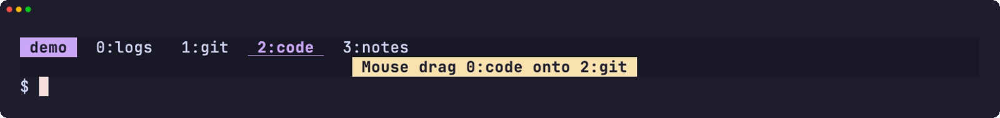<br><sub>タブを別のタブへドラッグ。<code>hero.tape</code>より</sub></td>
<td width="50%" valign="top">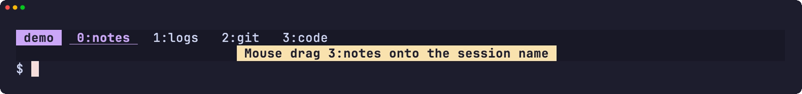<br><sub>セッション名に落としたタブは先頭へ。<code>hero.tape</code>より</sub></td>
</tr>
<tr>
<td width="50%" valign="top">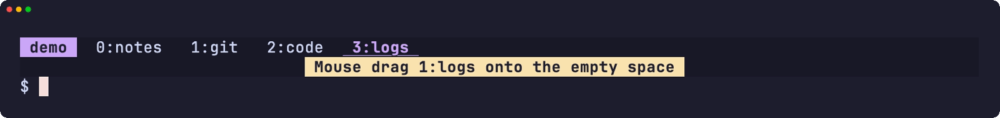<br><sub>空いた場所に落としたタブは末尾へ。<code>hero.tape</code>より</sub></td>
<td width="50%" valign="top">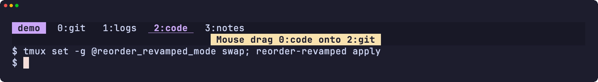<br><sub><code>@reorder_revamped_mode swap</code> は 2 つのウィンドウを入れ替える。<code>stills.tape</code>より</sub></td>
</tr>
<tr>
<td width="50%" valign="top">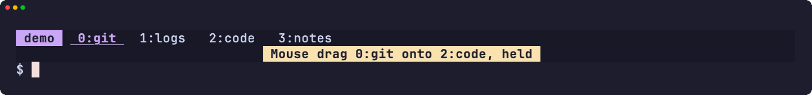<br><sub><code>@reorder_revamped_live off</code> はドラッグ中タブを動かさない。<code>stills.tape</code>より</sub></td>
<td width="50%" valign="top">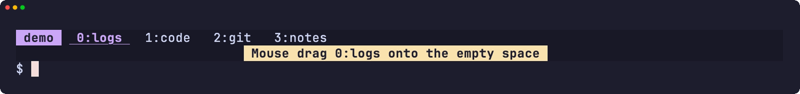<br><sub><code>@reorder_revamped_edges off</code> は空いた場所を無視する。<code>stills.tape</code>より</sub></td>
</tr>
<tr>
<td width="50%" valign="top">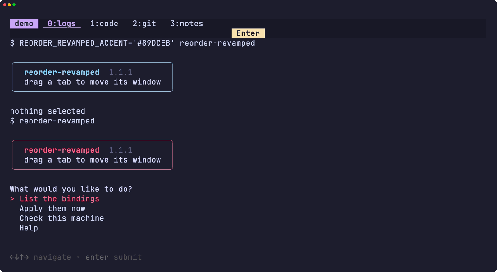<br><sub>メニュー。<code>stills.tape</code>より</sub></td>
<td width="50%" valign="top">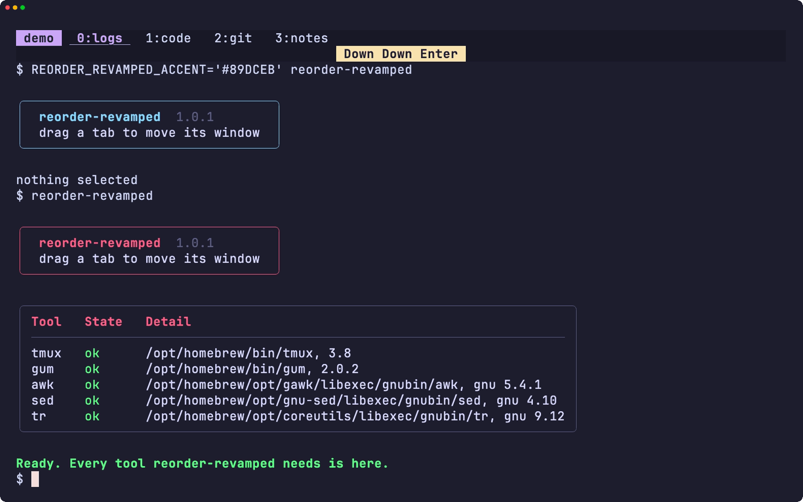<br><sub><code>doctor</code>。<code>stills.tape</code>より</sub></td>
</tr>
<tr>
<td width="50%" valign="top">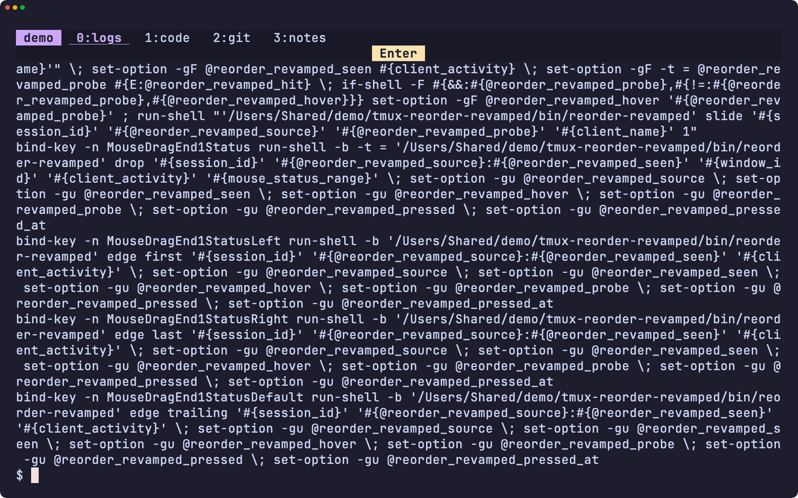<br><sub><code>list</code>。<code>stills.tape</code>より</sub></td>
<td width="50%" valign="top">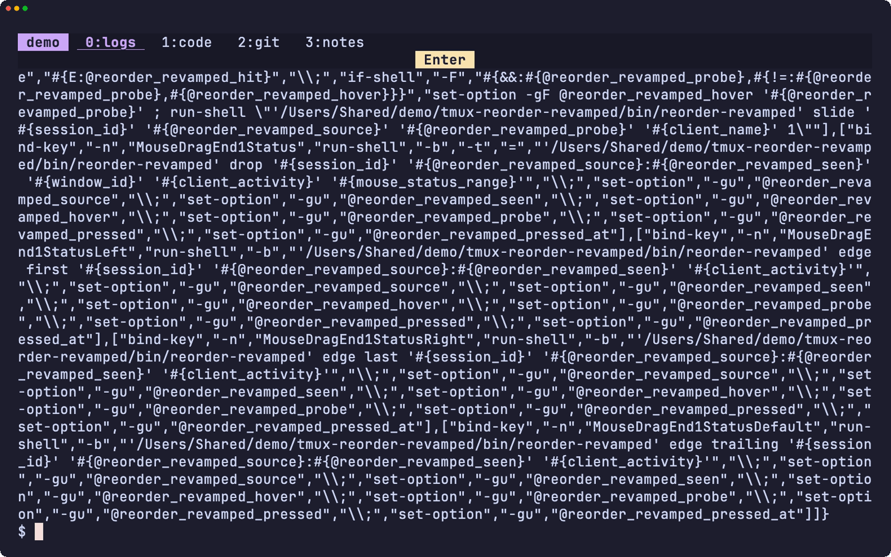<br><sub><code>list --json</code>。<code>stills.tape</code>より</sub></td>
</tr>
<tr>
<td width="50%" valign="top">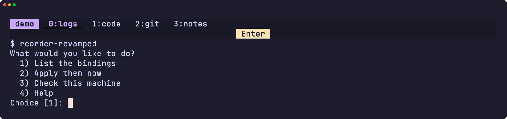<br><sub>gum なしのメニュー。<code>stills.tape</code>より</sub></td>
<td width="50%" valign="top">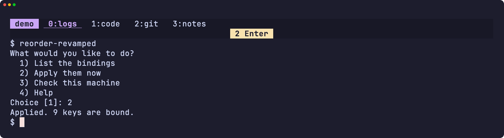<br><sub>メニューからの <code>apply</code>。<code>stills.tape</code>より</sub></td>
</tr>
<tr>
<td width="50%" valign="top">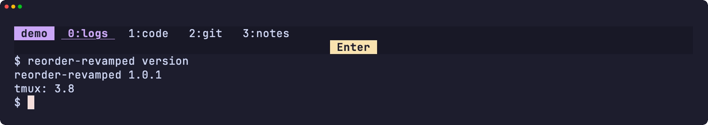<br><sub>バージョン。<code>stills.tape</code>より</sub></td>
<td width="50%" valign="top">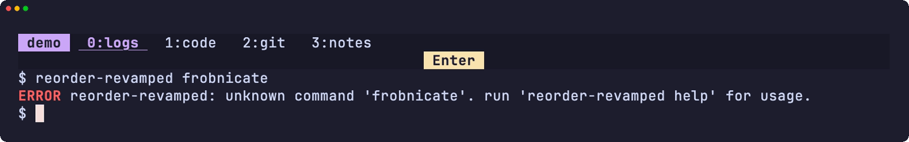<br><sub>不明なコマンド。<code>stills.tape</code>より</sub></td>
</tr>
<tr>
<td width="50%" valign="top">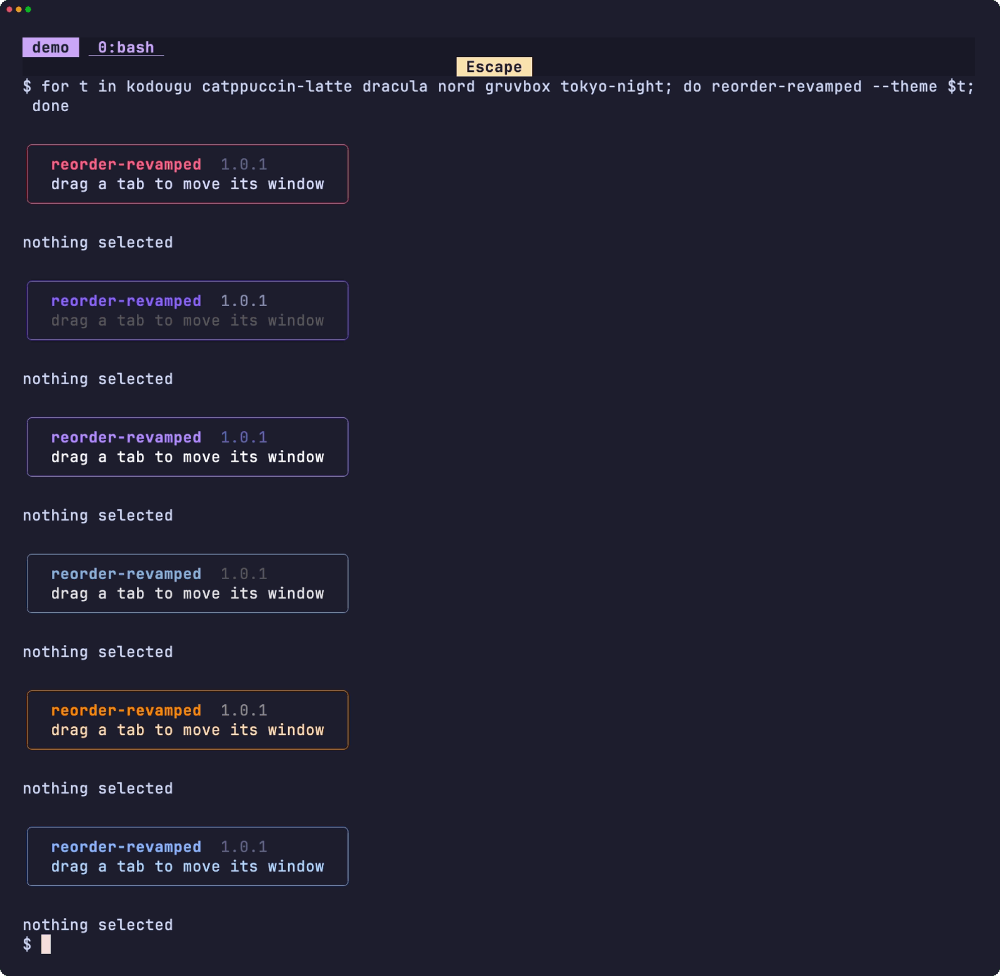<br><sub>6 つのテーマのヘッダー。<code>themes.tape</code>より</sub></td>
<td width="50%" valign="top">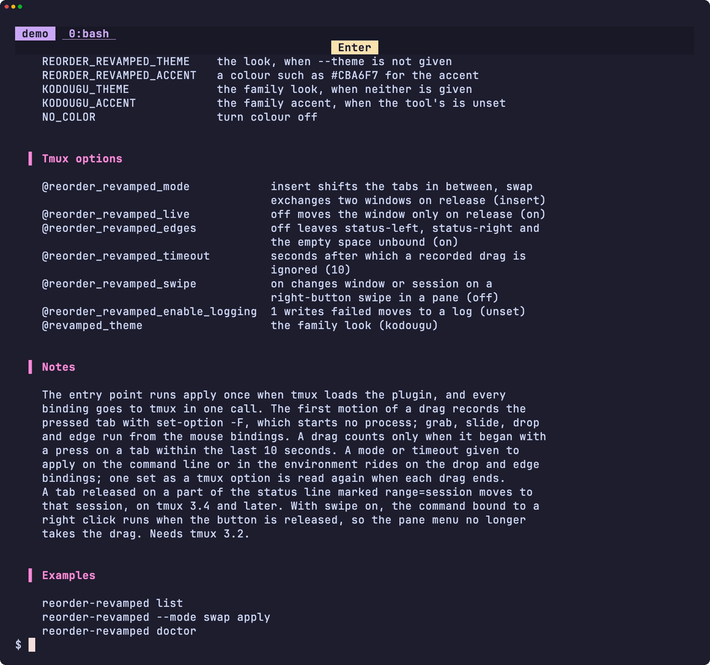<br><sub>ヘルプ。<code>help.tape</code>より</sub></td>
</tr>
<tr>
<td width="50%" valign="top">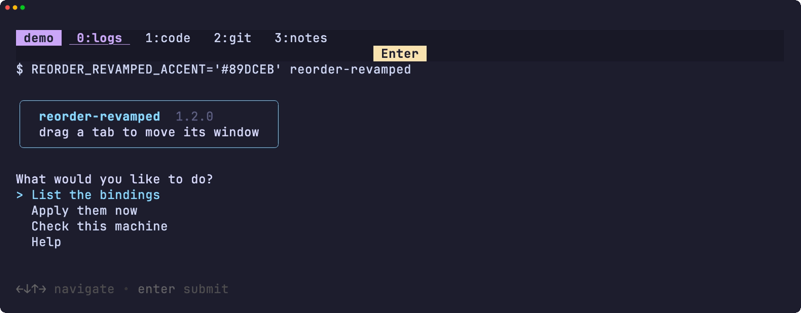<br><sub><code>REORDER_REVAMPED_ACCENT</code> によるアクセント。<code>stills.tape</code>より</sub></td>
<td width="50%" valign="top"></td>
</tr>
</table>

</details>

## 移植性

プラグインは POSIX `sh` です。CI は下の各行ですべてのテストを実行します。

| シェル | 状態 |
|:------|:-------|
| `dash`、macOS の `/bin/sh` | 対応 |
| `bash` 3.2 と 5.x、システムの `zsh` と Homebrew の `zsh` | 対応 |

| システム | 状態 |
|:-------|:-------|
| macOS | Apple Silicon と Intel の Tahoe。付属のツール、Homebrew の GNU ツール、Homebrew の uutils で確認 |
| Linux | x86_64 と arm64 の Ubuntu 26.04。GNU coreutils、uutils、BusyBox で確認 |

## 開発

| コマンド | 実行内容 |
|:--------|:-------------|
| `make fmt` | すべてのスクリプトに shfmt `-i 2` をかけます |
| `make lint` | shfmt、ShellCheck、mandoc、yamllint、actionlint を、指摘ゼロで通します |
| `make test` | システムの `sh` で bats のテスト |
| `make test-all` | インストール済みのすべてのシェルでテスト。macOS では bash と zsh の両方のビルドを含みます |
| `make test-linux` | Ubuntu のコンテナでテスト |
| `make coverage` | この Mac と Ubuntu のコンテナで bashcov を実行し、合算して 100 パーセントで判定します |
| `make screens` | 上の画面を、本物のプラグインから tmux の中で VHS で録画します。macOS で実行します |
| `make install` | コマンド、manページ、補完を `PREFIX` の下に置きます |

コミットは Conventional Commits の形式に従い、そのまま `main` に入ります。`main` で `ci` が成功すると、`release.yml` が semantic-release を実行します。前回のタグ以降に `feat` か `fix` があればリリースを公開し、バージョン定数を更新し、変更内容を [`CHANGELOG.md`](CHANGELOG.md) に追加します。

## ライセンス

[MIT](LICENSE)、copyright Gustavo Franco。

<!-- family:begin -->

## tmux-revamped ファミリー

このプラグインは tmux-revamped ファミリーの一員です。すべてのメンバーが [`FAMILY.md`](FAMILY.md) の同じ規約と同じ共有ライブラリを持ちます。メンバーは一緒にインストールする前提で作られており、ほかのメンバーが使うキーや tmux オプションを使うメンバーはありません。

あるメンバーで見つかった不具合は、修正完了とする前に全メンバーで同じ不具合を探します。

| メンバー | 機能 |
|---|---|
| [`tmux-autoreload-revamped`](https://github.com/tmux-revamped/tmux-autoreload-revamped) | tmuxの設定を編集して保存するだけで、キーもコマンドも使わずに自動で再読み込みされます |
| [`tmux-battery-revamped`](https://github.com/tmux-revamped/tmux-battery-revamped) | tmuxのステータスバーに電池の状態を表示し、ステータスの描画を一切止めません |
| [`tmux-bluetooth-revamped`](https://github.com/tmux-revamped/tmux-bluetooth-revamped) | 接続中のすべてのBluetooth機器とその電池残量をtmuxのステータスバーに表示し、描画を止めません |
| [`tmux-cpu-revamped`](https://github.com/tmux-revamped/tmux-cpu-revamped) | CPUの負荷、温度、周波数をtmuxのステータスバーに表示し、描画を一切止めません |
| [`tmux-disk-revamped`](https://github.com/tmux-revamped/tmux-disk-revamped) | tmuxのステータスバーにディスク使用量を表示し、ステータスの描画を一切止めません |
| [`tmux-extract-revamped`](https://github.com/tmux-revamped/tmux-extract-revamped) | 画面上の URL、パス、ハッシュなどのトークンを fzf で選び、カーソル位置に入力します。純粋なシェルだけで動きます |
| [`tmux-fzf-revamped`](https://github.com/tmux-revamped/tmux-fzf-revamped) | ポップアップ内の fzf ピッカーから、tmux のセッション、ウィンドウ、ペインの切り替え、終了、名前変更、作成を行います |
| [`tmux-git-revamped`](https://github.com/tmux-revamped/tmux-git-revamped) | アクティブなペインのgitブランチ、変更、プロバイダーの件数を、描画を止めずにtmuxのステータスバーに表示します |
| [`tmux-gpu-revamped`](https://github.com/tmux-revamped/tmux-gpu-revamped) | NVIDIA、AMD、Intel、Apple の GPU の負荷、温度、クロック、電力、メモリを tmux のステータスバーに表示します |
| [`tmux-kube-revamped`](https://github.com/tmux-revamped/tmux-kube-revamped) | 現在の Kubernetes コンテキストと名前空間を、kubectl を使わずに kubeconfig から解析して tmux のステータスバーに表示します |
| [`tmux-launcher-revamped`](https://github.com/tmux-revamped/tmux-launcher-revamped) | 任意の TUI アプリを、現在のペインのディレクトリでポップアップまたはウィンドウとして起動します。アプリごとにキーを設定できます |
| [`tmux-logging-revamped`](https://github.com/tmux-revamped/tmux-logging-revamped) | 任意のペインをファイルに保存します。ライブのログ記録、スクロールバック全体、1 回限りのスクリーンショットに対応します |
| [`tmux-music-revamped`](https://github.com/tmux-revamped/tmux-music-revamped) | 再生中の曲をステータスバーに表示し、ステータスの描画を止めません |
| [`tmux-network-revamped`](https://github.com/tmux-revamped/tmux-network-revamped) | ネットワークのスループットをステータスバーに表示し、描画を止めません |
| [`tmux-pain-control-revamped`](https://github.com/tmux-revamped/tmux-pain-control-revamped) | tmux のペインとウィンドウの操作キー。tmux のバージョンに対応し、vim と共存でき、どの prefix キーも無効にできます |
| [`tmux-persist-revamped`](https://github.com/tmux-revamped/tmux-persist-revamped) | tmuxのすべてのセッション、ウィンドウ、ペインを保存し、タイマーで自動保存して、再起動後にすべて復元します |
| [`tmux-plugin-template`](https://github.com/tmux-revamped/tmux-plugin-template) | tmux-revampedプラグインの出発点です。共有ライブラリ、batsハーネス、CIを含みます |
| [`tmux-pomodoro-revamped`](https://github.com/tmux-revamped/tmux-pomodoro-revamped) | すべての状態をtmuxオプションに保持し、一時ファイルを使わない、tmuxステータスバーのポモドーロタイマーです |
| [`tmux-ram-revamped`](https://github.com/tmux-revamped/tmux-ram-revamped) | RAM、スワップ、メモリプレッシャーをtmuxのステータスバーに表示します。計測はバックグラウンドで行うため描画を待たせません |
| [`tmux-reorder-revamped`](https://github.com/tmux-revamped/tmux-reorder-revamped) | **このプラグイン**、tmuxのステータスバー上でウィンドウのタブをマウスでドラッグして、そのウィンドウを移動します |
| [`tmux-scroll-revamped`](https://github.com/tmux-revamped/tmux-scroll-revamped) | 自分でスクロールできるアプリにはマウスホイールを渡し、それ以外ではtmuxのコピーモードに入ります |
| [`tmux-sensible-revamped`](https://github.com/tmux-revamped/tmux-sensible-revamped) | tmuxのバージョンと端末に合わせて適用され、ユーザーが設定したオプションには触れない、妥当な初期設定です |
| [`tmux-tiling-revamped`](https://github.com/tmux-revamped/tmux-tiling-revamped) | tmuxのタイル型ウィンドウ管理です。BSPのdwindleとspiralを含む8つのレイアウトと、レイアウトの取り消しがあります |
| [`tmux-time-revamped`](https://github.com/tmux-revamped/tmux-time-revamped) | ステータスバーにローカル時計と世界時計を時間帯ごとの色で表示し、カウントダウンと夏時間の警告も出します |
| [`tmux-weather-revamped`](https://github.com/tmux-revamped/tmux-weather-revamped) | wttr.inの天気をバックグラウンドで取得し、ステータスバーを待たせずに表示します |

<!-- family:end -->
