<div align="center">

# tmux-reorder-revamped

<strong>Drag a window tab along the tmux status bar with the mouse to move that window.</strong>

English &nbsp;|&nbsp; [日本語](README.ja.md) &nbsp;|&nbsp; [简体中文](README.zh-Hans.md) &nbsp;|&nbsp; [繁體中文（香港）](README.zh-HK.md)

[](https://github.com/tmux-revamped/tmux-reorder-revamped/actions/workflows/ci.yml)
[](https://github.com/tmux-revamped/tmux-reorder-revamped/releases/latest)
[](https://scorecard.dev/viewer/?uri=github.com/tmux-revamped/tmux-reorder-revamped)
[](LICENSE)

<p align="center">
  <a href="#quick-start"><strong>Quick start</strong></a> &nbsp;|&nbsp;
  <a href="#usage">Usage</a> &nbsp;|&nbsp;
  <a href="#how-it-works">How it works</a> &nbsp;|&nbsp;
  <a href="#screens">Screens</a>
</p>

</div>

<p align="center">
  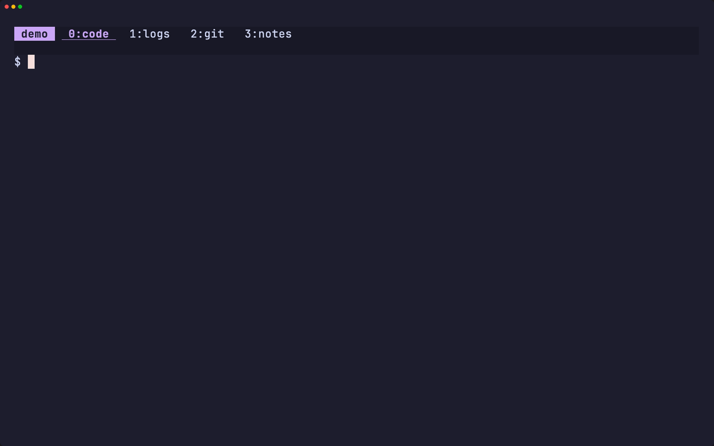
</p>

```console
$ reorder-revamped list | cut -c1-72
set-option -g @reorder_revamped_hit #{window_id}
set-option -g @reorder_revamped_press_original switch-client -t =
bind-key -n MouseDown1Status set-option -gF -t = @reorder_revamped_press
bind-key -n SecondClick1Status set-option -gF -t = @reorder_revamped_pre
bind-key -n TripleClick1Status set-option -gF -t = @reorder_revamped_pre
bind-key -n MouseUp1Status set-option -gu @reorder_revamped_pressed \; s
bind-key -n MouseDrag1Status if-shell -F #{&&:#{@reorder_revamped_presse
bind-key -n MouseDragEnd1Status run-shell -b -t = '/home/user/.tmux/plug
bind-key -n MouseDragEnd1StatusLeft run-shell -b '/home/user/.tmux/plugi
bind-key -n MouseDragEnd1StatusRight run-shell -b '/home/user/.tmux/plug
bind-key -n MouseDragEnd1StatusDefault run-shell -b '/home/user/.tmux/pl
```

Press a tab, drag it along the status bar and let go: the window moves there and the tabs in between shift over. The tab slides under the pointer while you drag, a drop on the session name or the right end moves the window to the start or the end, and a press on a tab still selects its window as before.

---

## Quick start

### Prerequisites

| Tool | Version | Used for |
|:-----|:--------|:---------|
| tmux | 3.2 or later | the drag and drop; the live slide measures the tabs on 3.8 and later |
| gum | optional | the menu, tables and colours of `reorder-revamped`; without it every command prints plain text |

### Install

```tmux
set -g @plugin 'tmux-revamped/tmux-reorder-revamped'
set -g mouse on
```

Then press `prefix + I`. Without TPM, clone the repository and run its entry point from `~/.tmux.conf`:

```bash
git clone https://github.com/tmux-revamped/tmux-reorder-revamped ~/.tmux/plugins/tmux-reorder-revamped
```

```tmux
run-shell ~/.tmux/plugins/tmux-reorder-revamped/reorder-revamped.tmux
```

`make install` in the clone also puts `reorder-revamped` in `~/.local/bin`, with its man page and completions under `~/.local/share`.

### Verify

```bash
~/.tmux/plugins/tmux-reorder-revamped/bin/reorder-revamped doctor
```

## Usage

With tmux's `mouse` option on, drag a tab. All bindings live in the root table, because a mouse gesture has no prefix; the plugin binds no prefix key.

| Mouse | Action |
|:------|:-------|
| Press a tab | Records the tab, then runs the press command that was there before, `switch-client -t =` by default |
| Drag a tab | Slides the window under the pointer whenever the pointer enters another tab |
| Release on a tab | Moves the window to that tab |
| Release on the session name | Moves the window first, when edges are on |
| Release on the right end | Moves the window last, when edges are on |
| Release on the empty space | Moves the window last when the window list is left-justified, when edges are on |

| Command | What it does |
|:--------|:-------------|
| `reorder-revamped apply` | Binds the mouse keys now; the entry point runs it when tmux loads the plugin |
| `reorder-revamped list` | Prints every binding apply would make; `--json` prints one object |
| `reorder-revamped grab`, `slide`, `drop`, `edge` | Run from the mouse bindings: measure the tabs, slide, drop on a tab, drop on an end |
| `reorder-revamped doctor` | One row per dependency |
| `reorder-revamped version` | The version, then the tmux version |
| `reorder-revamped help` | The help page; `man reorder-revamped` documents the same commands and settings |
| `reorder-revamped` | On a terminal, a menu |

| tmux option | Default | Meaning |
|:------------|:--------|:--------|
| `@reorder_revamped_mode` | `insert` | `insert` moves the window and shifts the ones in between; `swap` exchanges only the two windows, on release, with no live slide |
| `@reorder_revamped_live` | `on` | `off` keeps the tabs still while you drag and moves the window only on release |
| `@reorder_revamped_edges` | `on` | `off` leaves the session name, the right end and the empty space unbound |
| `@reorder_revamped_timeout` | `10` | Seconds of client activity after which a recorded drag is ignored, so a drag abandoned over a pane cannot move a window on a later release |
| `@reorder_revamped_enable_logging` | unset | `1` writes failed moves to `~/.tmux/reorder-revamped-logs/` |

Mode, live and edges shape the bindings, so run `reorder-revamped apply` or reload the config after changing them. Every option is also a command option with dashes, such as `--edges off`, and an environment variable, such as `REORDER_REVAMPED_EDGES`; the command line wins over the environment, and the environment over the tmux option. A mode or timeout given to `apply` on the command line or in the environment also rides on every drop; one set as a tmux option is read again when each drag ends. An empty tmux option means its default.

The plugin keeps its drag state in `@reorder_revamped_source`, `_seen`, `_hit`, `_probe`, `_hover`, `_pressed`, `_pressed_at` and `_press_original`. Do not set them.

<a id="how-it-works"></a>

## How it works

The first motion of a drag names the tab you pressed and stores it in a server option with `set-option -F`, which starts no process. On tmux 3.2 to 3.7, tmux reports the tab under the pointer directly. On 3.8 and later it keeps reporting the tab where the drag started, so `grab` measures every tab with tmux's own `#{w:}` width modifier when the drag starts and stores a format that turns `mouse_x` into the tab under the pointer.

Only when the pointer enters a different tab does `slide` run: one tmux command of adjacent `swap-window -d` steps that also remeasures the tabs. Measuring needs a left-justified, single-line status bar whose window list fits; otherwise the window moves on release only.

A drag counts only when it began with a press on a tab within the last 10 seconds, so a text selection that starts in a pane and crosses the bar moves nothing.

<a id="screens"></a>

## Screens

<details>
<summary>Every screen, recorded inside a real tmux with <code>make screens</code>, with each mouse gesture and key on the status line</summary>
<br>

<table>
<tr>
<td width="50%" valign="top">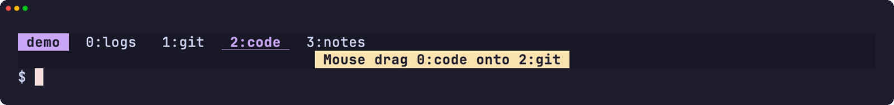<br><sub>A tab dragged onto another tab, from <code>hero.tape</code></sub></td>
<td width="50%" valign="top">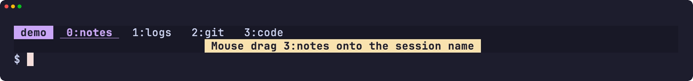<br><sub>A tab dropped on the session name moves first, from <code>hero.tape</code></sub></td>
</tr>
<tr>
<td width="50%" valign="top">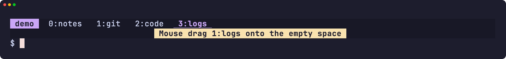<br><sub>A tab dropped on the empty space moves last, from <code>hero.tape</code></sub></td>
<td width="50%" valign="top">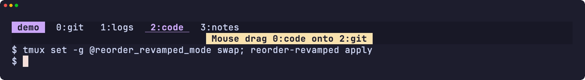<br><sub><code>@reorder_revamped_mode swap</code> exchanges two windows, from <code>stills.tape</code></sub></td>
</tr>
<tr>
<td width="50%" valign="top">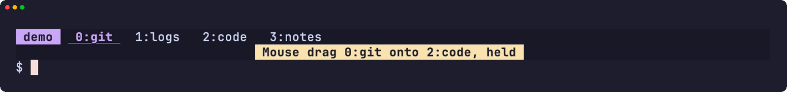<br><sub><code>@reorder_revamped_live off</code> keeps the tabs still while dragging, from <code>stills.tape</code></sub></td>
<td width="50%" valign="top">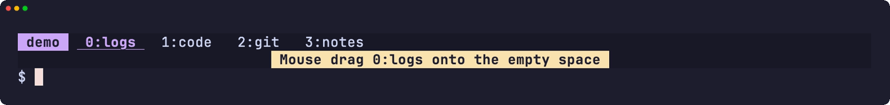<br><sub><code>@reorder_revamped_edges off</code> ignores the empty space, from <code>stills.tape</code></sub></td>
</tr>
<tr>
<td width="50%" valign="top">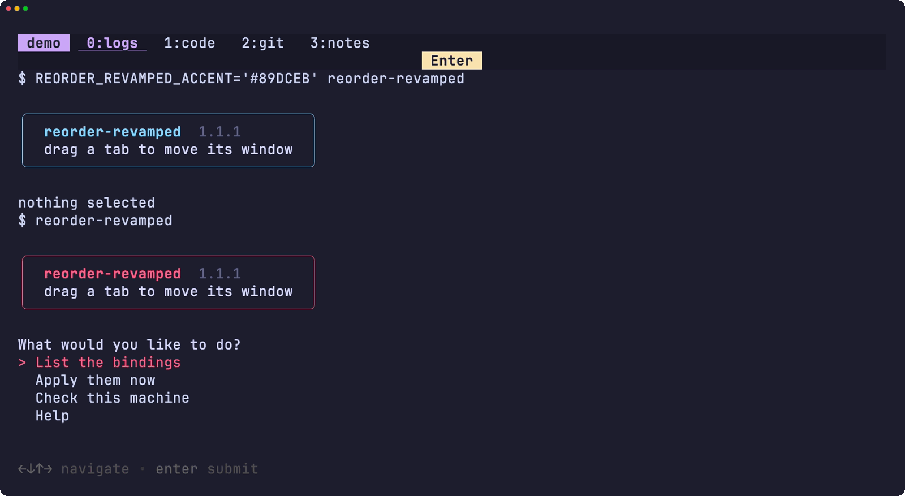<br><sub>The menu, from <code>stills.tape</code></sub></td>
<td width="50%" valign="top">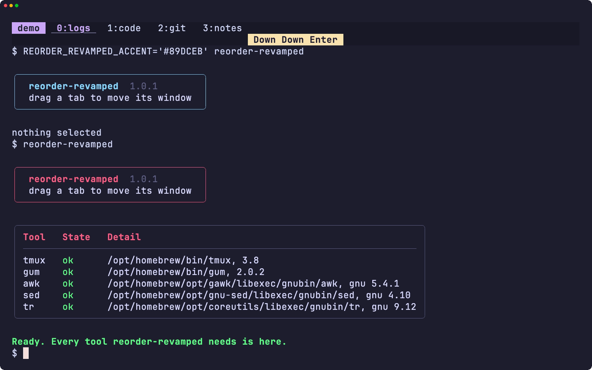<br><sub><code>doctor</code>, from <code>stills.tape</code></sub></td>
</tr>
<tr>
<td width="50%" valign="top">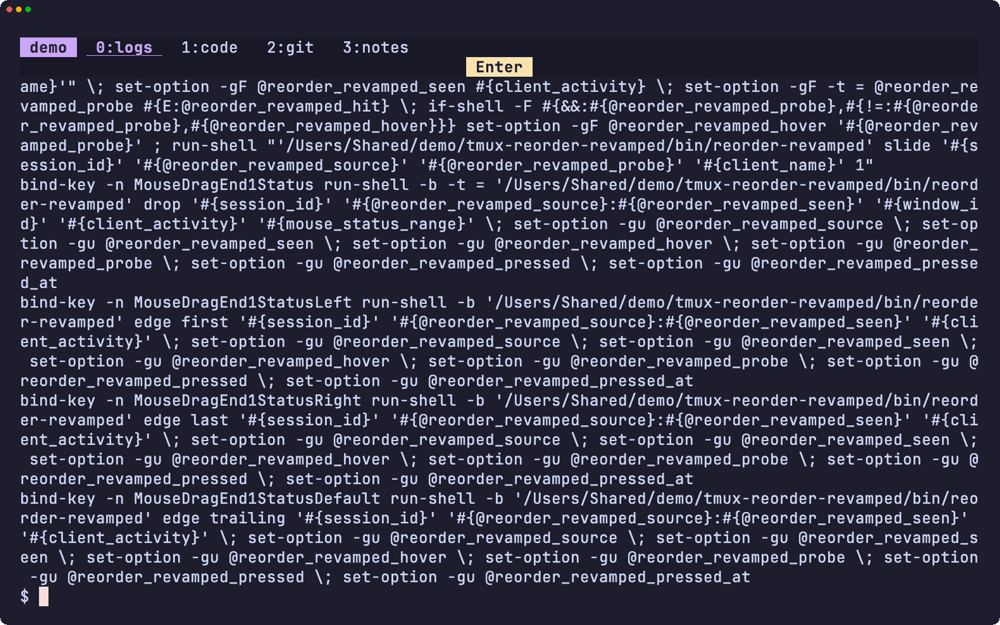<br><sub><code>list</code>, from <code>stills.tape</code></sub></td>
<td width="50%" valign="top">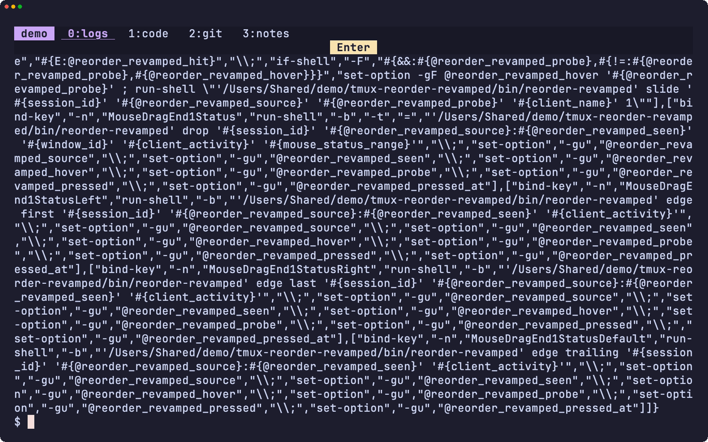<br><sub><code>list --json</code>, from <code>stills.tape</code></sub></td>
</tr>
<tr>
<td width="50%" valign="top">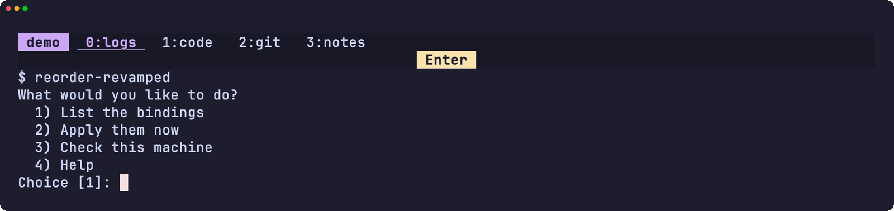<br><sub>The menu without gum, from <code>stills.tape</code></sub></td>
<td width="50%" valign="top">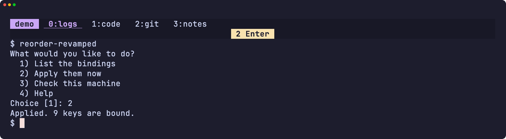<br><sub><code>apply</code> from the menu, from <code>stills.tape</code></sub></td>
</tr>
<tr>
<td width="50%" valign="top">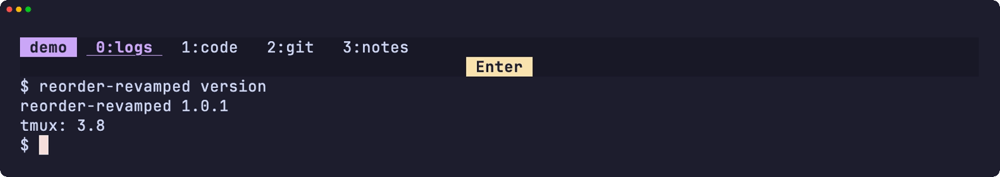<br><sub>The version, from <code>stills.tape</code></sub></td>
<td width="50%" valign="top">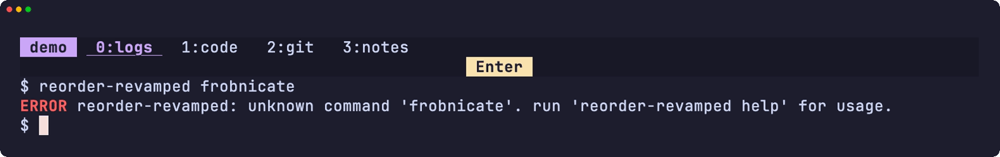<br><sub>An unknown command, from <code>stills.tape</code></sub></td>
</tr>
<tr>
<td width="50%" valign="top">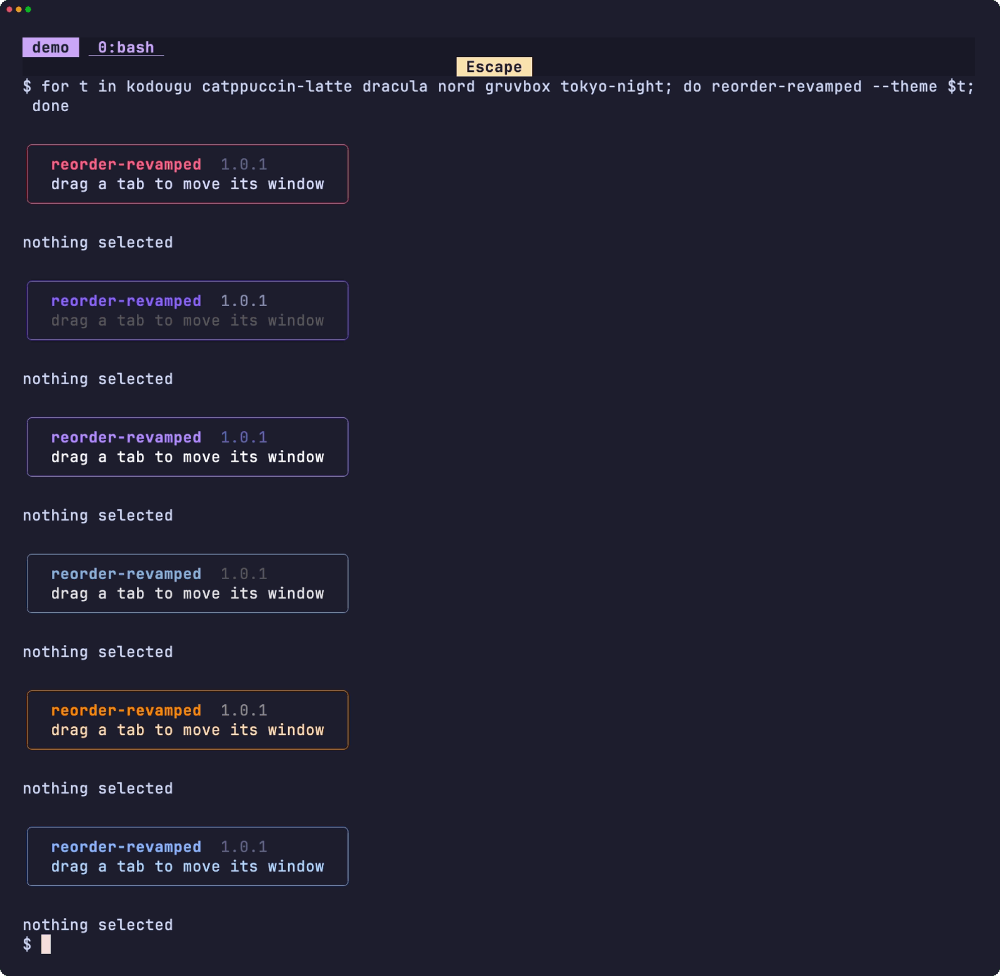<br><sub>The header in six themes, from <code>themes.tape</code></sub></td>
<td width="50%" valign="top">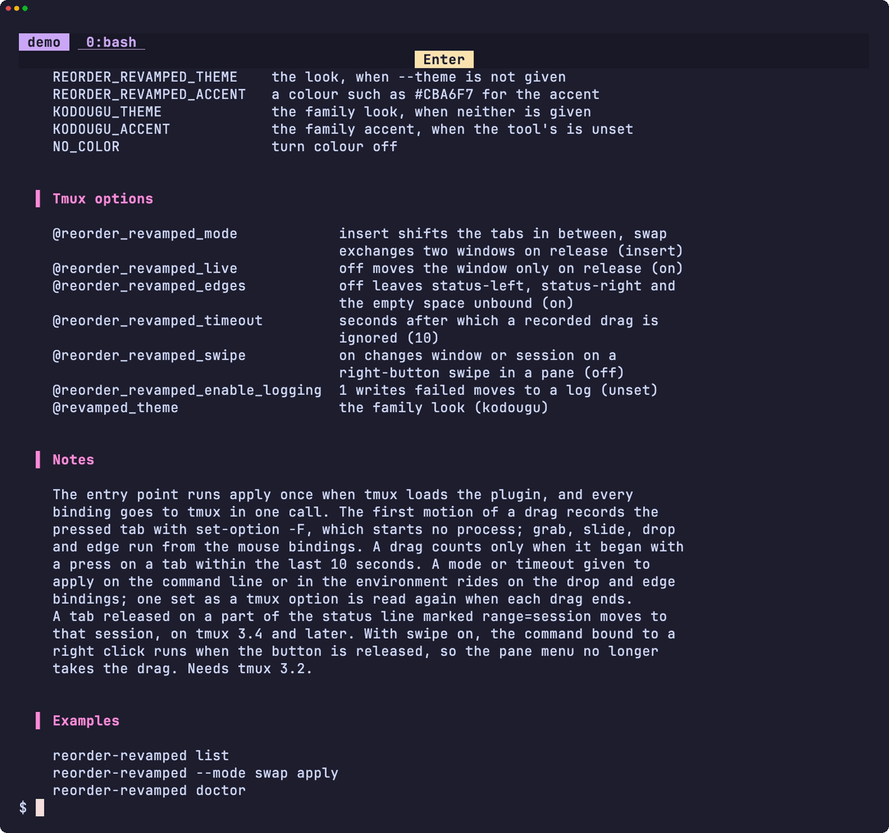<br><sub>The help page, from <code>help.tape</code></sub></td>
</tr>
<tr>
<td width="50%" valign="top">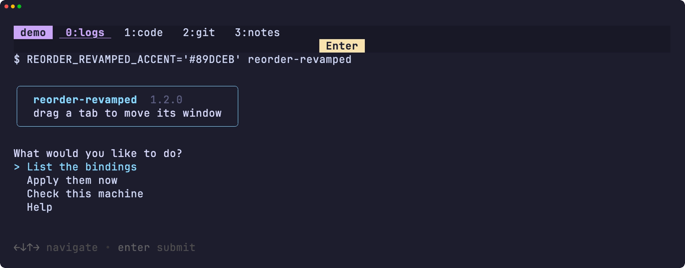<br><sub>An accent from <code>REORDER_REVAMPED_ACCENT</code>, from <code>stills.tape</code></sub></td>
<td width="50%" valign="top"></td>
</tr>
</table>

</details>

## Portability

The plugin is POSIX `sh`. CI runs every suite on each row below.

| Shell | Status |
|:------|:-------|
| `dash`, `/bin/sh` on macOS | Supported |
| `bash` 3.2 and 5.x, the system's `zsh` and Homebrew's | Supported |

| System | Status |
|:-------|:-------|
| macOS | Tahoe on Apple Silicon and Intel, with the tools it ships, Homebrew's GNU tools and Homebrew's uutils |
| Linux | Ubuntu 26.04 on x86_64 and arm64, with GNU coreutils, uutils and BusyBox |

## Development

| Command | What it runs |
|:--------|:-------------|
| `make fmt` | shfmt `-i 2` on every script |
| `make lint` | shfmt, ShellCheck, mandoc, yamllint and actionlint, at zero findings |
| `make test` | The bats suites under the system `sh`, real mouse drags included |
| `make test-all` | The suites under every installed shell, both builds of bash and zsh on macOS |
| `make test-linux` | The suites in an Ubuntu container |
| `make coverage` | bashcov on this Mac and in the Ubuntu container, merged and gated at 100 percent |
| `make screens` | The screens above, recorded from the real plugin inside tmux with VHS, on macOS |
| `make install` | The command, its man page and completions under `PREFIX` |

Commits follow the conventional commit format and go straight to `main`. After a green `ci` run on `main`, `release.yml` runs semantic-release: every `feat` or `fix` since the last tag publishes a release, stamps the version constant and adds the notes to [`CHANGELOG.md`](CHANGELOG.md).

## License

[MIT](LICENSE), copyright Gustavo Franco.

<!-- family:begin -->

## The tmux-revamped family

This plugin is one member of the tmux-revamped family. Every member carries the same contract in [`FAMILY.md`](FAMILY.md) and the same shared library, and they are built to be installed together: no member claims a key or a tmux option that another member claims.

A defect found in one member is hunted across all of them before the fix is called done.

| Member | What it does |
|---|---|
| [`tmux-autoreload-revamped`](https://github.com/tmux-revamped/tmux-autoreload-revamped) | Edit your tmux config, save, and watch it reload itself, no key, no command |
| [`tmux-battery-revamped`](https://github.com/tmux-revamped/tmux-battery-revamped) | Battery status for your tmux status bar, without ever blocking the status render |
| [`tmux-bluetooth-revamped`](https://github.com/tmux-revamped/tmux-bluetooth-revamped) | Every connected Bluetooth device and its battery in your tmux status bar, without blocking the render |
| [`tmux-cpu-revamped`](https://github.com/tmux-revamped/tmux-cpu-revamped) | CPU load, temperature, and frequency in your tmux status bar, without ever blocking the render |
| [`tmux-disk-revamped`](https://github.com/tmux-revamped/tmux-disk-revamped) | Disk usage for your tmux status bar, without ever blocking the status render |
| [`tmux-extract-revamped`](https://github.com/tmux-revamped/tmux-extract-revamped) | Pick a URL, path, hash or any other token off the screen with fzf and type it at the cursor, in pure shell |
| [`tmux-fzf-revamped`](https://github.com/tmux-revamped/tmux-fzf-revamped) | Switch to, kill, rename or create tmux sessions, windows and panes from fzf pickers in a popup |
| [`tmux-git-revamped`](https://github.com/tmux-revamped/tmux-git-revamped) | Show the active pane's git branch, changes and provider counts in the tmux status bar without blocking it |
| [`tmux-gpu-revamped`](https://github.com/tmux-revamped/tmux-gpu-revamped) | GPU load, temperature, clock, power and memory in the tmux status bar, from NVIDIA, AMD, Intel and Apple GPUs |
| [`tmux-kube-revamped`](https://github.com/tmux-revamped/tmux-kube-revamped) | Current Kubernetes context and namespace in the tmux status bar, parsed from kubeconfig without kubectl |
| [`tmux-launcher-revamped`](https://github.com/tmux-revamped/tmux-launcher-revamped) | Open any terminal app in a tmux popup, window or split from one menu, starting at the project root |
| [`tmux-logging-revamped`](https://github.com/tmux-revamped/tmux-logging-revamped) | Capture any pane to a file: live logging, full scrollback, or a one-shot screenshot |
| [`tmux-music-revamped`](https://github.com/tmux-revamped/tmux-music-revamped) | Now playing in your tmux status bar, without ever blocking the status render |
| [`tmux-network-revamped`](https://github.com/tmux-revamped/tmux-network-revamped) | Network throughput in your tmux status bar, without ever blocking the render |
| [`tmux-pain-control-revamped`](https://github.com/tmux-revamped/tmux-pain-control-revamped) | Pane and window management bindings for tmux, version aware, vim friendly, every prefix key can be disabled |
| [`tmux-persist-revamped`](https://github.com/tmux-revamped/tmux-persist-revamped) | Save every tmux session, window and pane, auto-save on a timer, and restore it all after a reboot |
| [`tmux-plugin-template`](https://github.com/tmux-revamped/tmux-plugin-template) | The starting point for a tmux-revamped plugin: shared library, bats harness and CI |
| [`tmux-pomodoro-revamped`](https://github.com/tmux-revamped/tmux-pomodoro-revamped) | A Pomodoro timer in the tmux status bar that keeps all of its state in tmux options, with no temp files |
| [`tmux-ram-revamped`](https://github.com/tmux-revamped/tmux-ram-revamped) | RAM, swap and memory pressure in the tmux status bar, sampled in the background so the render never waits |
| [`tmux-reorder-revamped`](https://github.com/tmux-revamped/tmux-reorder-revamped) | **this plugin**, Drag a window tab along the tmux status bar with the mouse to move that window |
| [`tmux-scroll-revamped`](https://github.com/tmux-revamped/tmux-scroll-revamped) | Send the mouse wheel to apps that scroll themselves and into tmux copy-mode everywhere else |
| [`tmux-sensible-revamped`](https://github.com/tmux-revamped/tmux-sensible-revamped) | Sensible tmux defaults, gated by tmux version and terminal, that leave the options you set alone |
| [`tmux-tiling-revamped`](https://github.com/tmux-revamped/tmux-tiling-revamped) | Tiling window management for tmux: eight layouts including BSP dwindle and spiral, with layout undo |
| [`tmux-time-revamped`](https://github.com/tmux-revamped/tmux-time-revamped) | Local and world clocks for the tmux status bar, colored by time of day, with countdowns and a DST warning |
| [`tmux-weather-revamped`](https://github.com/tmux-revamped/tmux-weather-revamped) | Weather for the tmux status bar from wttr.in, fetched in the background so the status line never waits |

<!-- family:end -->
