<div align="center">

# tmux-reorder-revamped

<strong>在 tmux 狀態列上用滑鼠拖動視窗標籤，即可移動該視窗。</strong>

[English](README.md) &nbsp;|&nbsp; [日本語](README.ja.md) &nbsp;|&nbsp; [简体中文](README.zh-Hans.md) &nbsp;|&nbsp; 繁體中文（香港）

[](https://github.com/tmux-revamped/tmux-reorder-revamped/actions/workflows/ci.yml)
[](https://github.com/tmux-revamped/tmux-reorder-revamped/releases/latest)
[](https://scorecard.dev/viewer/?uri=github.com/tmux-revamped/tmux-reorder-revamped)
[](LICENSE)

<p align="center">
  <a href="#快速開始"><strong>快速開始</strong></a> &nbsp;|&nbsp;
  <a href="#用法">用法</a> &nbsp;|&nbsp;
  <a href="#運作原理">運作原理</a> &nbsp;|&nbsp;
  <a href="#畫面">畫面</a>
</p>

</div>

<p align="center">
  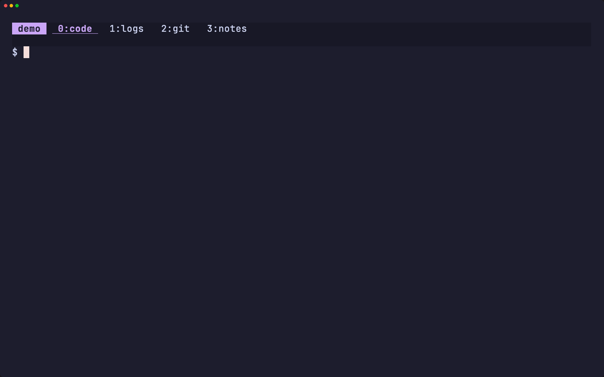
</p>

```console
$ reorder-revamped list | cut -c1-72
set-option -g @reorder_revamped_hit #{window_id}
set-option -g @reorder_revamped_press_original switch-client -t =
bind-key -n MouseDown1Status set-option -gF -t = @reorder_revamped_press
bind-key -n SecondClick1Status set-option -gF -t = @reorder_revamped_pre
bind-key -n TripleClick1Status set-option -gF -t = @reorder_revamped_pre
bind-key -n MouseUp1Status set-option -gu @reorder_revamped_pressed \; s
bind-key -n MouseDrag1Status if-shell -F #{&&:#{@reorder_revamped_presse
bind-key -n MouseDragEnd1Status run-shell -b -t = '/home/user/.tmux/plug
bind-key -n MouseDragEnd1StatusLeft run-shell -b '/home/user/.tmux/plugi
bind-key -n MouseDragEnd1StatusRight run-shell -b '/home/user/.tmux/plug
bind-key -n MouseDragEnd1StatusDefault run-shell -b '/home/user/.tmux/pl
```

按住一個標籤，沿狀態列拖動後放開：視窗移到那裏，中間的標籤順序挪開。拖動時標籤會在指標下滑動；放到工作階段名稱上或右端，視窗會移到最前或最後。按下標籤仍像以前一樣選取它的視窗。

---

## 快速開始

### 前提條件

| 工具 | 版本 | 用途 |
|:-----|:--------|:---------|
| tmux | 3.2 或以上 | 拖放；在 3.8 或以後，即時滑動會量度各個標籤 |
| gum | 可選 | `reorder-revamped` 的選單、表格和顏色；沒有它，所有命令都輸出純文字 |

### 安裝

```tmux
set -g @plugin 'tmux-revamped/tmux-reorder-revamped'
set -g mouse on
```

然後按 `prefix + I`。不使用 TPM 時，複製儲存庫，並在 `~/.tmux.conf` 中執行它的入口腳本：

```bash
git clone https://github.com/tmux-revamped/tmux-reorder-revamped ~/.tmux/plugins/tmux-reorder-revamped
```

```tmux
run-shell ~/.tmux/plugins/tmux-reorder-revamped/reorder-revamped.tmux
```

在複製的目錄中執行 `make install`，亦會把 `reorder-revamped` 放入 `~/.local/bin`，並把它的 man 手冊和自動完成放在 `~/.local/share` 下。

### 驗證

```bash
~/.tmux/plugins/tmux-reorder-revamped/bin/reorder-revamped doctor
```

## 用法

開啟 tmux 的 `mouse` 選項後拖動標籤。滑鼠手勢沒有前置鍵，所以所有綁定都在根表中；插件不綁定任何前置鍵。

| 滑鼠 | 作用 |
|:------|:-------|
| 按下標籤 | 記錄該標籤，然後執行原有的按下命令，預設是 `switch-client -t =` |
| 拖動標籤 | 指標每進入另一個標籤，就把視窗滑到指標下 |
| 在標籤上放開 | 把視窗移到該標籤 |
| 在工作階段名稱上放開 | edges 開啟時，把視窗移到最前 |
| 在右端放開 | edges 開啟時，把視窗移到最後 |
| 在空白處放開 | edges 開啟且視窗列表靠左對齊時，把視窗移到最後 |

| 命令 | 作用 |
|:--------|:-------------|
| `reorder-revamped apply` | 立即綁定滑鼠鍵；插件載入時入口點會執行它 |
| `reorder-revamped list` | 列出 apply 會做的每個綁定；`--json` 輸出一個物件 |
| `reorder-revamped grab`, `slide`, `drop`, `edge` | 由滑鼠綁定執行：量度標籤、滑動、放到標籤上、放到一端 |
| `reorder-revamped doctor` | 每個依賴一行 |
| `reorder-revamped version` | 版本，然後是 tmux 版本 |
| `reorder-revamped help` | 說明頁；`man reorder-revamped` 記錄相同的命令和設定 |
| `reorder-revamped` | 在終端機上顯示選單 |

| tmux 選項 | 預設值 | 含義 |
|:------------|:--------|:--------|
| `@reorder_revamped_mode` | `insert` | `insert` 移動視窗並讓中間的視窗順序挪開；`swap` 在放開時只交換兩個視窗，沒有即時滑動 |
| `@reorder_revamped_live` | `on` | `off` 時拖動中標籤不動，放開時才移動視窗 |
| `@reorder_revamped_edges` | `on` | `off` 時不綁定工作階段名稱、右端和空白處 |
| `@reorder_revamped_timeout` | `10` | 記錄的拖動在用戶端活動多少秒後被忽略，這樣在窗格上放棄的拖動不會在之後放開時移動視窗 |
| `@reorder_revamped_enable_logging` | 未設定 | `1` 時把失敗的移動寫入 `~/.tmux/reorder-revamped-logs/` |

mode、live 和 edges 決定綁定的形式，修改後請執行 `reorder-revamped apply` 或重新載入設定。每個選項亦可寫成以短橫線連接的命令選項，例如 `--edges off`，以及環境變數，例如 `REORDER_REVAMPED_EDGES`；命令列優先於環境變數，環境變數優先於 tmux 選項。空的 tmux 選項表示使用預設值。

插件把拖動狀態保存在 `@reorder_revamped_source`、`_seen`、`_hit`、`_probe`、`_hover`、`_pressed`、`_pressed_at` 和 `_press_original` 中。請不要設定它們。

<a id="運作原理"></a>

## 運作原理

拖動的第一次移動會用 `set-option -F` 把按下的標籤存入伺服器選項，不會啟動任何程序。在 tmux 3.2 至 3.7 上，tmux 直接報告指標下的標籤。3.8 或以後它會一直報告開始拖動的標籤，所以拖動開始時 `grab` 用 tmux 自己的 `#{w:}` 寬度修飾符量度每個標籤，並保存一個把 `mouse_x` 轉換成指標下標籤的格式。

只有指標進入另一個標籤時才執行 `slide`：一條由相鄰 `swap-window -d` 步驟組成的 tmux 命令，並在同一命令中重新量度標籤。量度需要靠左對齊、單行且放得下視窗列表的狀態列；否則視窗只在放開時移動。

只有在最近 10 秒內由按下標籤開始的拖動才算數，所以由窗格內開始、越過狀態列的文字選取不會移動任何視窗。

<a id="畫面"></a>

## 畫面

<details>
<summary>所有畫面，在真實的 tmux 中用 <code>make screens</code> 錄製，每個滑鼠手勢和按鍵顯示在狀態列上</summary>
<br>

<table>
<tr>
<td width="50%" valign="top">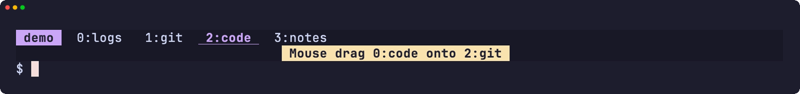<br><sub>把標籤拖到另一個標籤上，來自 <code>hero.tape</code></sub></td>
<td width="50%" valign="top">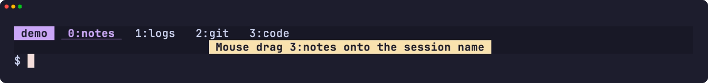<br><sub>放到工作階段名稱上的標籤移到最前，來自 <code>hero.tape</code></sub></td>
</tr>
<tr>
<td width="50%" valign="top">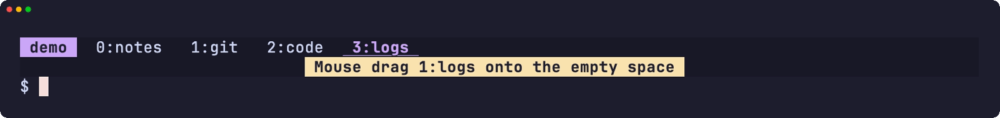<br><sub>放到空白處的標籤移到最後，來自 <code>hero.tape</code></sub></td>
<td width="50%" valign="top">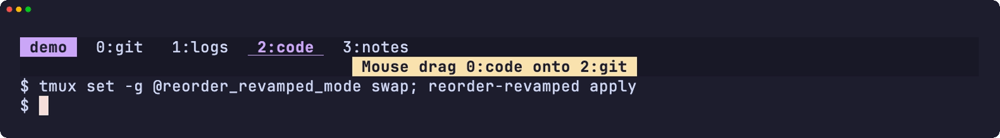<br><sub><code>@reorder_revamped_mode swap</code> 交換兩個視窗，來自 <code>stills.tape</code></sub></td>
</tr>
<tr>
<td width="50%" valign="top">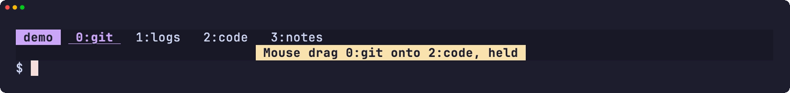<br><sub><code>@reorder_revamped_live off</code> 拖動時標籤不動，來自 <code>stills.tape</code></sub></td>
<td width="50%" valign="top">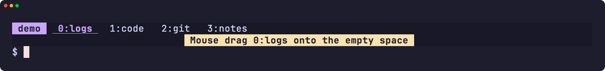<br><sub><code>@reorder_revamped_edges off</code> 忽略空白處，來自 <code>stills.tape</code></sub></td>
</tr>
<tr>
<td width="50%" valign="top">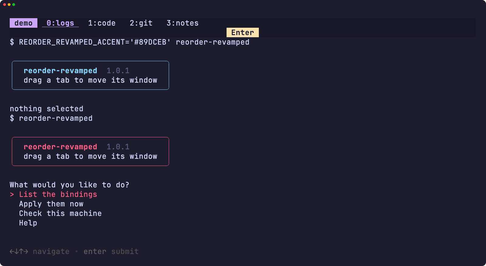<br><sub>選單，來自 <code>stills.tape</code></sub></td>
<td width="50%" valign="top">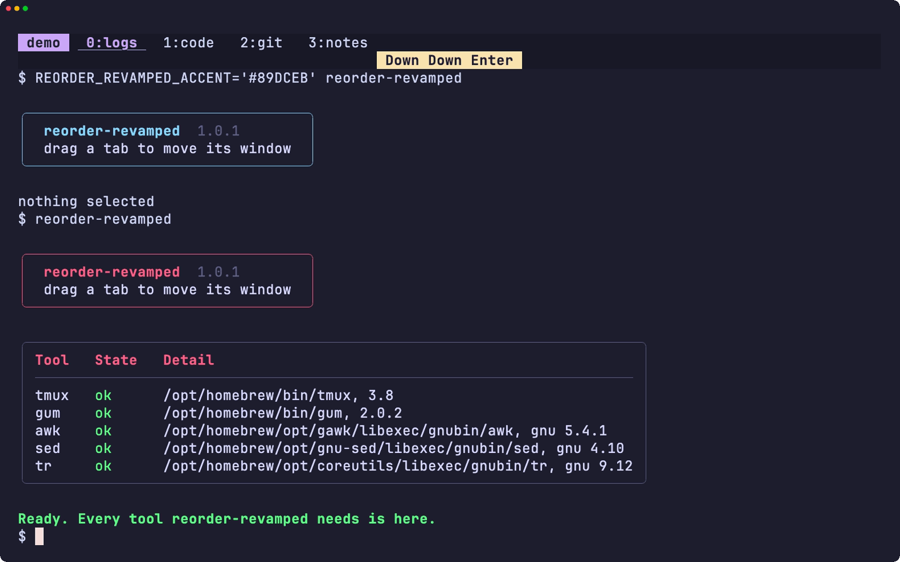<br><sub><code>doctor</code>，來自 <code>stills.tape</code></sub></td>
</tr>
<tr>
<td width="50%" valign="top">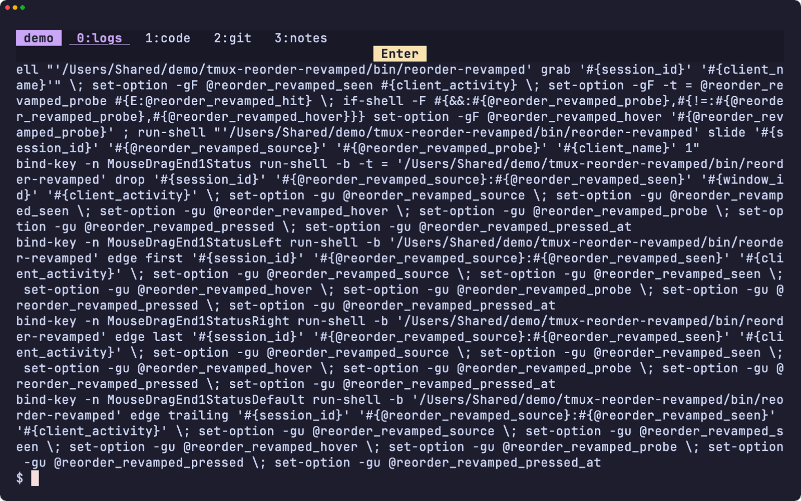<br><sub><code>list</code>，來自 <code>stills.tape</code></sub></td>
<td width="50%" valign="top">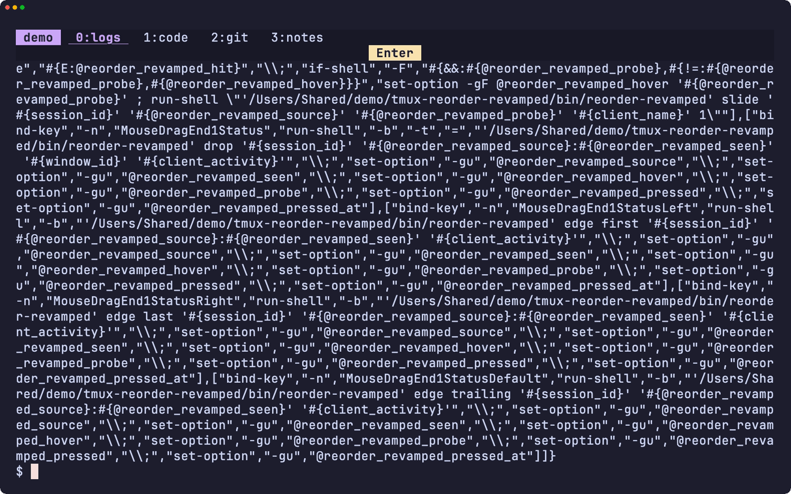<br><sub><code>list --json</code>，來自 <code>stills.tape</code></sub></td>
</tr>
<tr>
<td width="50%" valign="top">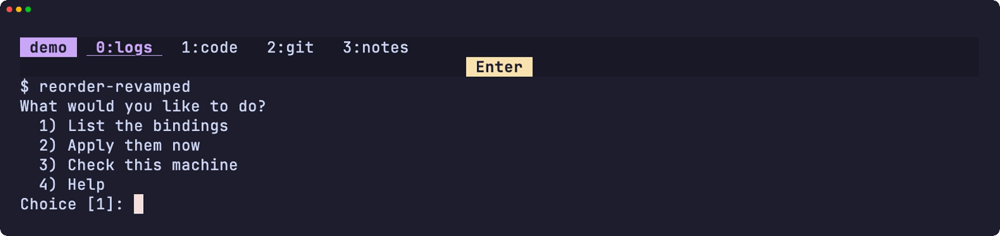<br><sub>沒有 gum 的選單，來自 <code>stills.tape</code></sub></td>
<td width="50%" valign="top">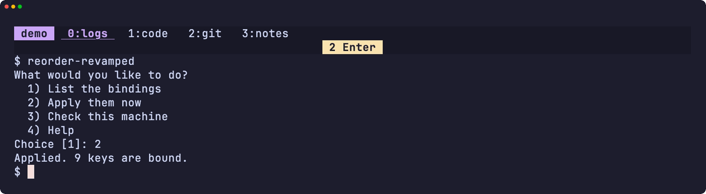<br><sub>從選單執行 <code>apply</code>，來自 <code>stills.tape</code></sub></td>
</tr>
<tr>
<td width="50%" valign="top">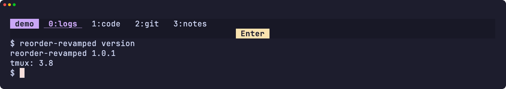<br><sub>版本，來自 <code>stills.tape</code></sub></td>
<td width="50%" valign="top">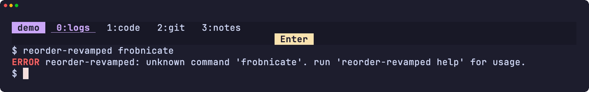<br><sub>不明命令，來自 <code>stills.tape</code></sub></td>
</tr>
<tr>
<td width="50%" valign="top">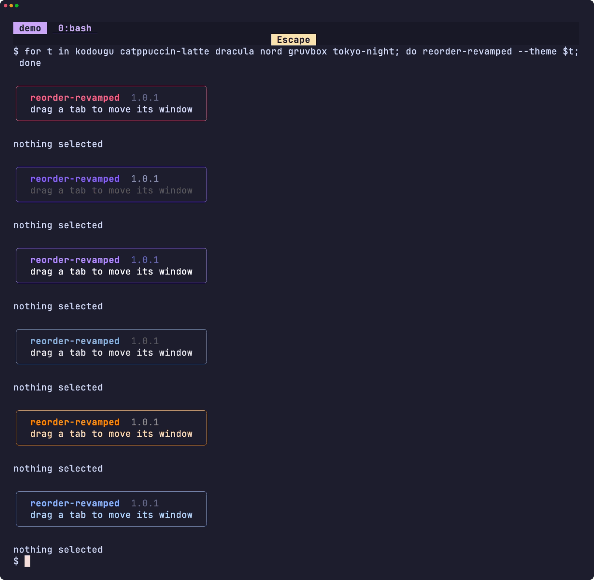<br><sub>六種主題下的標題，來自 <code>themes.tape</code></sub></td>
<td width="50%" valign="top">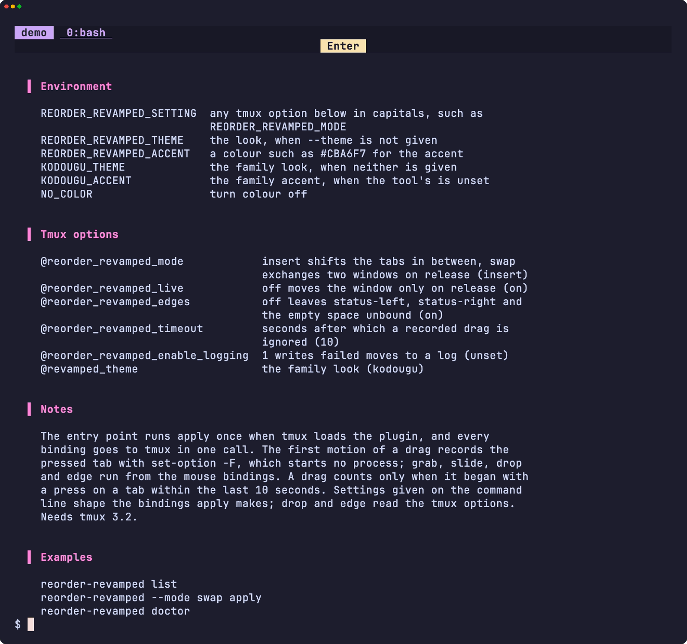<br><sub>說明頁，來自 <code>help.tape</code></sub></td>
</tr>
<tr>
<td width="50%" valign="top">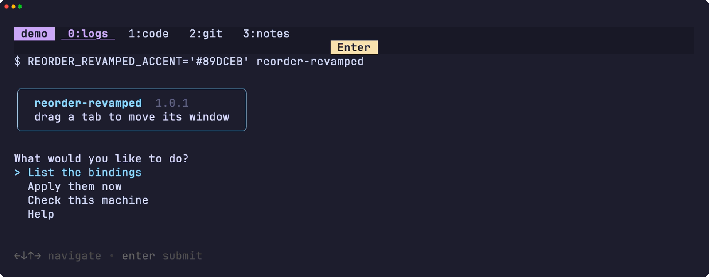<br><sub>來自 <code>REORDER_REVAMPED_ACCENT</code> 的強調色，來自 <code>stills.tape</code></sub></td>
<td width="50%" valign="top"></td>
</tr>
</table>

</details>

## 可攜性

插件是 POSIX `sh`。CI 在下列每一行上執行全部測試。

| Shell | 狀態 |
|:------|:-------|
| `dash`、macOS 上的 `/bin/sh` | 支援 |
| `bash` 3.2 和 5.x、系統內建的 `zsh` 和 Homebrew 的 `zsh` | 支援 |

| 系統 | 狀態 |
|:-------|:-------|
| macOS | Apple Silicon 和 Intel 上的 Tahoe，使用內建的工具、Homebrew 的 GNU 工具和 Homebrew 的 uutils |
| Linux | x86_64 和 arm64 上的 Ubuntu 26.04，使用 GNU coreutils、uutils 和 BusyBox |

## 開發

| 指令 | 執行內容 |
|:--------|:-------------|
| `make fmt` | 對每個腳本執行 shfmt `-i 2` |
| `make lint` | shfmt、ShellCheck、mandoc、yamllint 和 actionlint，零警告 |
| `make test` | 在系統 `sh` 下執行 bats 測試 |
| `make test-all` | 在每個已安裝的 shell 下執行測試，macOS 上包括 bash 和 zsh 的兩種版本 |
| `make test-linux` | 在 Ubuntu 容器中執行測試 |
| `make coverage` | 在這部 Mac 和 Ubuntu 容器中執行 bashcov，合併後以 100% 為門檻 |
| `make screens` | 以 VHS 在 tmux 中從真實插件錄製上述畫面，在 macOS 上執行 |
| `make install` | 把指令、man 手冊和自動完成安裝到 `PREFIX` 下 |

提交遵循 Conventional Commits 格式，直接進入 `main`。`main` 上的 `ci` 通過後，`release.yml` 會執行 semantic-release：自上一個標籤以來的每個 `feat` 或 `fix` 都會發佈新版本，更新版本常數，並把說明寫入 [`CHANGELOG.md`](CHANGELOG.md)。

## 授權

[MIT](LICENSE)，copyright Gustavo Franco。

<!-- family:begin -->

## tmux-revamped 插件家族

這個插件是 tmux-revamped 插件家族的一員。每個成員都帶有 [`FAMILY.md`](FAMILY.md) 中相同的約定和相同的共用程式庫，並且設計為一起安裝：沒有成員佔用另一個成員佔用的按鍵或 tmux 選項。

在一個成員中發現的缺陷，要在全部成員中排查後才算修正完成。

| 成員 | 功能 |
|---|---|
| [`tmux-autoreload-revamped`](https://github.com/tmux-revamped/tmux-autoreload-revamped) | 編輯並儲存 tmux 設定後，它會自動重新載入，毋須按鍵，也毋須指令 |
| [`tmux-battery-revamped`](https://github.com/tmux-revamped/tmux-battery-revamped) | 在 tmux 狀態列顯示電池狀態，從不阻塞狀態列繪製 |
| [`tmux-bluetooth-revamped`](https://github.com/tmux-revamped/tmux-bluetooth-revamped) | 在 tmux 狀態列顯示每部已連接的藍牙裝置及其電量，不阻塞繪製 |
| [`tmux-cpu-revamped`](https://github.com/tmux-revamped/tmux-cpu-revamped) | 在 tmux 狀態列顯示 CPU 負載、溫度及頻率，從不阻塞繪製 |
| [`tmux-disk-revamped`](https://github.com/tmux-revamped/tmux-disk-revamped) | 在 tmux 狀態列顯示磁碟用量，從不阻塞狀態列繪製 |
| [`tmux-extract-revamped`](https://github.com/tmux-revamped/tmux-extract-revamped) | 用 fzf 從畫面上揀選 URL、路徑、雜湊值或任何其他字詞，並輸入到游標位置，全部以純 shell 實現 |
| [`tmux-fzf-revamped`](https://github.com/tmux-revamped/tmux-fzf-revamped) | 在彈出視窗的 fzf 選擇器中切換、關閉、重新命名或建立 tmux 工作階段、視窗和窗格 |
| [`tmux-git-revamped`](https://github.com/tmux-revamped/tmux-git-revamped) | 在 tmux 狀態列顯示當前窗格的 git 分支、改動和託管平台數目，而不會阻塞顯示 |
| [`tmux-gpu-revamped`](https://github.com/tmux-revamped/tmux-gpu-revamped) | 在 tmux 狀態列顯示 NVIDIA、AMD、Intel 及 Apple GPU 的負載、溫度、時脈、功耗及記憶體 |
| [`tmux-kube-revamped`](https://github.com/tmux-revamped/tmux-kube-revamped) | 在 tmux 狀態列顯示目前的 Kubernetes 上下文及命名空間，毋須 kubectl，直接解析 kubeconfig |
| [`tmux-launcher-revamped`](https://github.com/tmux-revamped/tmux-launcher-revamped) | 在彈出視窗或新視窗中啟動任何 TUI 應用程式，從目前窗格的目錄開始，每個應用程式可設定一個按鍵 |
| [`tmux-logging-revamped`](https://github.com/tmux-revamped/tmux-logging-revamped) | 將任何窗格儲存到檔案：即時記錄、完整捲動緩衝區或一次性截圖 |
| [`tmux-music-revamped`](https://github.com/tmux-revamped/tmux-music-revamped) | 在 tmux 狀態列顯示正在播放的歌曲，從不阻塞狀態列的繪製 |
| [`tmux-network-revamped`](https://github.com/tmux-revamped/tmux-network-revamped) | 在 tmux 狀態列顯示網絡傳輸量，從不阻塞繪製 |
| [`tmux-pain-control-revamped`](https://github.com/tmux-revamped/tmux-pain-control-revamped) | tmux 的窗格和視窗管理按鍵，配合 tmux 版本，與 vim 相容，每個 prefix 按鍵都可停用 |
| [`tmux-persist-revamped`](https://github.com/tmux-revamped/tmux-persist-revamped) | 儲存 tmux 的所有工作階段、視窗及窗格，按計時器自動儲存，並在重新開機後全部還原 |
| [`tmux-plugin-template`](https://github.com/tmux-revamped/tmux-plugin-template) | tmux-revamped 插件的起點：共用程式庫、bats 測試框架和 CI |
| [`tmux-pomodoro-revamped`](https://github.com/tmux-revamped/tmux-pomodoro-revamped) | tmux 狀態列中的番茄鐘計時器，所有狀態都儲存在 tmux 選項中，不使用暫存檔 |
| [`tmux-ram-revamped`](https://github.com/tmux-revamped/tmux-ram-revamped) | 在 tmux 狀態列顯示記憶體、交換空間及記憶體壓力，在背景取樣，繪製從不等待 |
| [`tmux-reorder-revamped`](https://github.com/tmux-revamped/tmux-reorder-revamped) | **本插件**，用滑鼠在 tmux 狀態列上拖動視窗標籤來移動該視窗 |
| [`tmux-scroll-revamped`](https://github.com/tmux-revamped/tmux-scroll-revamped) | 將滑鼠滾輪交給能自行捲動的應用程式，其他情況下進入 tmux 複製模式 |
| [`tmux-sensible-revamped`](https://github.com/tmux-revamped/tmux-sensible-revamped) | 按 tmux 版本和終端機區分的合理預設設定，不會改動你自己設定的選項 |
| [`tmux-tiling-revamped`](https://github.com/tmux-revamped/tmux-tiling-revamped) | tmux 的平鋪視窗管理：八種版面，包括 BSP dwindle 和 spiral，並支援復原版面 |
| [`tmux-time-revamped`](https://github.com/tmux-revamped/tmux-time-revamped) | 狀態列中的本地時鐘和世界時鐘，按一天中的時段著色，並提供倒數和夏令時間提示 |
| [`tmux-weather-revamped`](https://github.com/tmux-revamped/tmux-weather-revamped) | 在背景從 wttr.in 取得天氣並顯示在狀態列，狀態列毋須等待 |

<!-- family:end -->
