<div align="center">

# tmux-reorder-revamped

<strong>在 tmux 状态栏上用鼠标拖动窗口标签，即可移动该窗口。</strong>

[English](README.md) &nbsp;|&nbsp; [日本語](README.ja.md) &nbsp;|&nbsp; 简体中文 &nbsp;|&nbsp; [繁體中文（香港）](README.zh-HK.md)

[](https://github.com/tmux-revamped/tmux-reorder-revamped/actions/workflows/ci.yml)
[](https://github.com/tmux-revamped/tmux-reorder-revamped/releases/latest)
[](https://scorecard.dev/viewer/?uri=github.com/tmux-revamped/tmux-reorder-revamped)
[](LICENSE)

<p align="center">
  <a href="#快速开始"><strong>快速开始</strong></a> &nbsp;|&nbsp;
  <a href="#用法">用法</a> &nbsp;|&nbsp;
  <a href="#工作原理">工作原理</a> &nbsp;|&nbsp;
  <a href="#界面">界面</a>
</p>

</div>

<p align="center">
  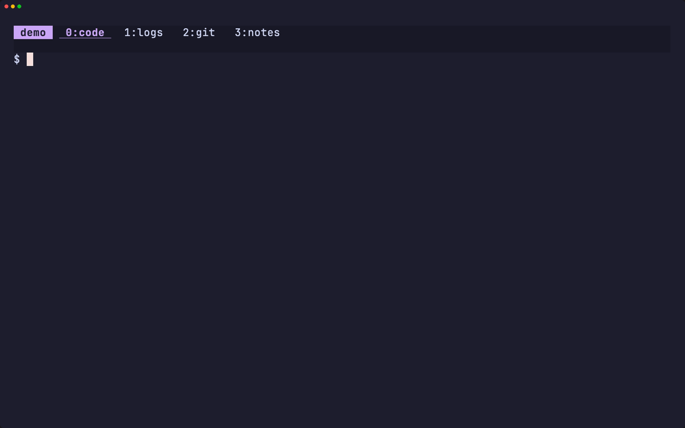
</p>

```console
$ reorder-revamped list | cut -c1-72
set-option -g @reorder_revamped_hit #{window_id}
set-option -g @reorder_revamped_press_original switch-client -t =
bind-key -n MouseDown1Status set-option -gF -t = @reorder_revamped_press
bind-key -n SecondClick1Status set-option -gF -t = @reorder_revamped_pre
bind-key -n TripleClick1Status set-option -gF -t = @reorder_revamped_pre
bind-key -n MouseUp1Status set-option -gu @reorder_revamped_pressed \; s
bind-key -n MouseDrag1Status if-shell -F #{&&:#{@reorder_revamped_presse
bind-key -n MouseDragEnd1Status run-shell -b -t = '/home/user/.tmux/plug
bind-key -n MouseDragEnd1StatusLeft run-shell -b '/home/user/.tmux/plugi
bind-key -n MouseDragEnd1StatusRight run-shell -b '/home/user/.tmux/plug
bind-key -n MouseDragEnd1StatusDefault run-shell -b '/home/user/.tmux/pl
```

按住一个标签，沿状态栏拖动后松开：窗口移到那里，中间的标签依次挪开。拖动时标签会在指针下滑动；放到会话名上或右端，窗口会移到最前或最后。单击标签仍像以前一样选中它的窗口。

---

## 快速开始

### 前提条件

| 工具 | 版本 | 用途 |
|:-----|:--------|:---------|
| tmux | 3.2 或更高 | 拖放；在 3.8 及以后，实时滑动会测量各个标签 |
| gum | 可选 | `reorder-revamped` 的菜单、表格和颜色；没有它，所有命令都输出纯文本 |

### 安装

```tmux
set -g @plugin 'tmux-revamped/tmux-reorder-revamped'
set -g mouse on
```

然后按 `prefix + I`。不用 TPM 时，克隆仓库，并在 `~/.tmux.conf` 中运行它的入口文件：

```bash
git clone https://github.com/tmux-revamped/tmux-reorder-revamped ~/.tmux/plugins/tmux-reorder-revamped
```

```tmux
run-shell ~/.tmux/plugins/tmux-reorder-revamped/reorder-revamped.tmux
```

在克隆的目录中运行 `make install`，还会把 `reorder-revamped` 放进 `~/.local/bin`，把它的 man 手册和补全放在 `~/.local/share` 下。

### 验证

```bash
~/.tmux/plugins/tmux-reorder-revamped/bin/reorder-revamped doctor
```

## 用法

打开 tmux 的 `mouse` 选项后拖动标签。鼠标手势没有前缀键，所以所有绑定都在根表中；插件不绑定任何前缀键。

| 鼠标 | 作用 |
|:------|:-------|
| 按下标签 | 记录该标签，然后运行原有的按下命令，默认是 `switch-client -t =` |
| 拖动标签 | 指针每进入另一个标签，就把窗口滑到指针下 |
| 在标签上松开 | 把窗口移到该标签 |
| 在会话名上松开 | edges 打开时，把窗口移到最前 |
| 在右端松开 | edges 打开时，把窗口移到最后 |
| 在空白处松开 | edges 打开且窗口列表左对齐时，把窗口移到最后 |

| 命令 | 作用 |
|:--------|:-------------|
| `reorder-revamped apply` | 立即绑定鼠标键；插件加载时入口点会运行它 |
| `reorder-revamped list` | 打印 apply 会做的每个绑定；`--json` 输出一个对象 |
| `reorder-revamped grab`, `slide`, `drop`, `edge` | 由鼠标绑定运行：测量标签、滑动、放到标签上、放到一端 |
| `reorder-revamped doctor` | 每个依赖一行 |
| `reorder-revamped version` | 版本，然后是 tmux 版本 |
| `reorder-revamped help` | 帮助页；`man reorder-revamped` 记录相同的命令和设置 |
| `reorder-revamped` | 在终端上显示菜单 |

| tmux 选项 | 默认值 | 含义 |
|:------------|:--------|:--------|
| `@reorder_revamped_mode` | `insert` | `insert` 移动窗口并让中间的窗口依次挪开；`swap` 在松开时只交换两个窗口，没有实时滑动 |
| `@reorder_revamped_live` | `on` | `off` 时拖动中标签不动，松开时才移动窗口 |
| `@reorder_revamped_edges` | `on` | `off` 时不绑定会话名、右端和空白处 |
| `@reorder_revamped_timeout` | `10` | 记录的拖动在客户端活动多少秒后被忽略，这样在窗格上放弃的拖动不会在之后松开时移动窗口 |
| `@reorder_revamped_enable_logging` | 未设置 | `1` 时把失败的移动写入 `~/.tmux/reorder-revamped-logs/` |

mode、live 和 edges 决定绑定的形式，修改后请运行 `reorder-revamped apply` 或重新加载配置。每个选项也可以写成用短横线连接的命令选项，例如 `--edges off`，以及环境变量，例如 `REORDER_REVAMPED_EDGES`；命令行优先于环境变量，环境变量优先于 tmux 选项。通过命令行或环境变量传给 `apply` 的 mode 和 timeout 也会带到每次放下；在 tmux 选项中设置的值会在每次拖动结束时重新读取。空的 tmux 选项表示使用默认值。

插件把拖动状态保存在 `@reorder_revamped_source`、`_seen`、`_hit`、`_probe`、`_hover`、`_pressed`、`_pressed_at` 和 `_press_original` 中。请不要设置它们。

<a id="工作原理"></a>

## 工作原理

拖动的第一次移动会用 `set-option -F` 把按下的标签存入服务器选项，不启动任何进程。在 tmux 3.2 到 3.7 上，tmux 直接报告指针下的标签。3.8 及以后它会一直报告开始拖动的标签，所以拖动开始时 `grab` 用 tmux 自己的 `#{w:}` 宽度修饰符测量每个标签，并保存一个把 `mouse_x` 转换成指针下标签的格式。

只有指针进入另一个标签时才运行 `slide`：一条由相邻 `swap-window -d` 步骤组成的 tmux 命令，并在同一命令中重新测量标签。测量需要左对齐、单行且能放下窗口列表的状态栏；否则窗口只在松开时移动。

只有在最近 10 秒内从按下标签开始的拖动才算数，所以从窗格里开始、越过状态栏的文本选择不会移动任何窗口。

<a id="界面"></a>

## 界面

<details>
<summary>所有界面，在真实的 tmux 中用 <code>make screens</code> 录制，每个鼠标手势和按键显示在状态栏上</summary>
<br>

<table>
<tr>
<td width="50%" valign="top">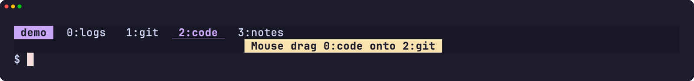<br><sub>把标签拖到另一个标签上，来自 <code>hero.tape</code></sub></td>
<td width="50%" valign="top">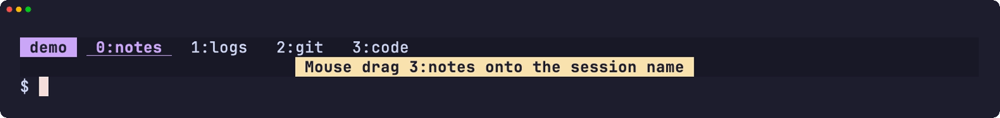<br><sub>放到会话名上的标签移到最前，来自 <code>hero.tape</code></sub></td>
</tr>
<tr>
<td width="50%" valign="top">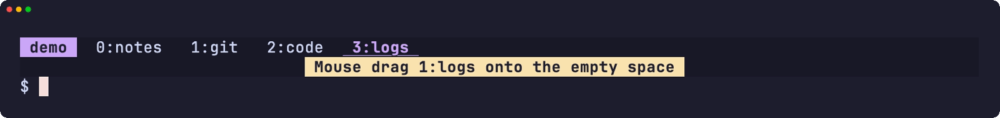<br><sub>放到空白处的标签移到最后，来自 <code>hero.tape</code></sub></td>
<td width="50%" valign="top">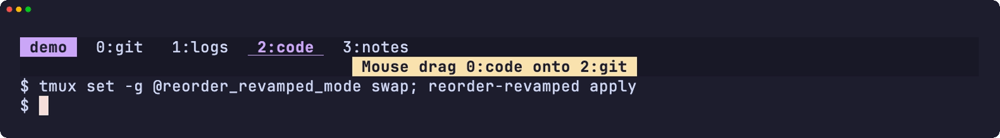<br><sub><code>@reorder_revamped_mode swap</code> 交换两个窗口，来自 <code>stills.tape</code></sub></td>
</tr>
<tr>
<td width="50%" valign="top">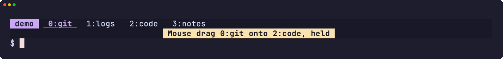<br><sub><code>@reorder_revamped_live off</code> 拖动时标签不动，来自 <code>stills.tape</code></sub></td>
<td width="50%" valign="top">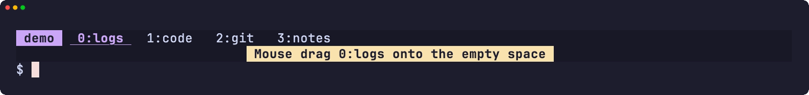<br><sub><code>@reorder_revamped_edges off</code> 忽略空白处，来自 <code>stills.tape</code></sub></td>
</tr>
<tr>
<td width="50%" valign="top">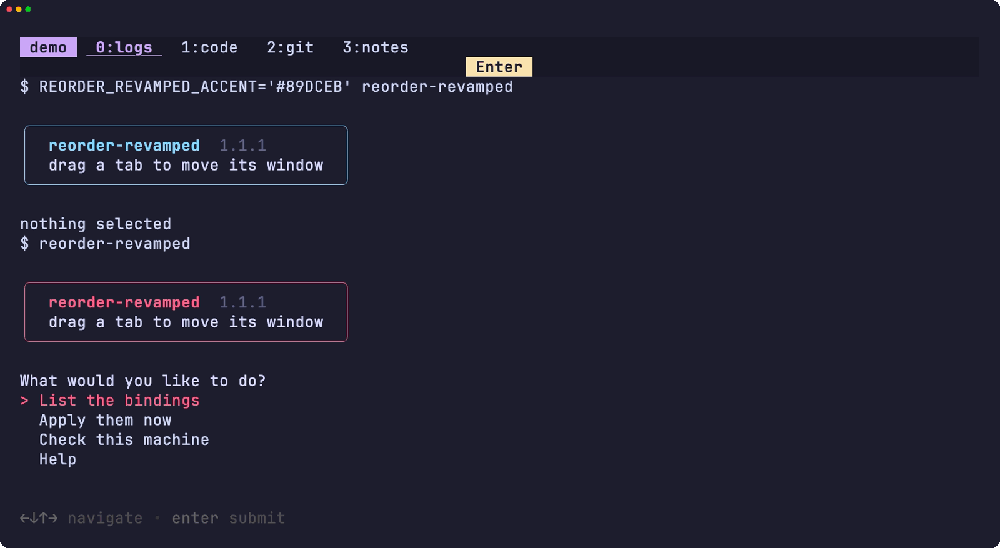<br><sub>菜单，来自 <code>stills.tape</code></sub></td>
<td width="50%" valign="top">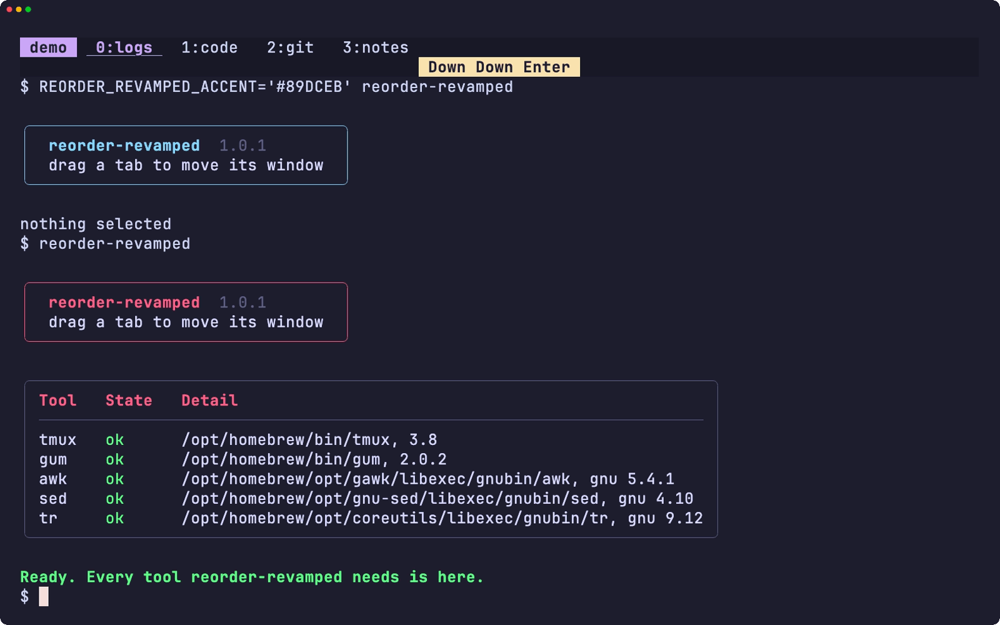<br><sub><code>doctor</code>，来自 <code>stills.tape</code></sub></td>
</tr>
<tr>
<td width="50%" valign="top">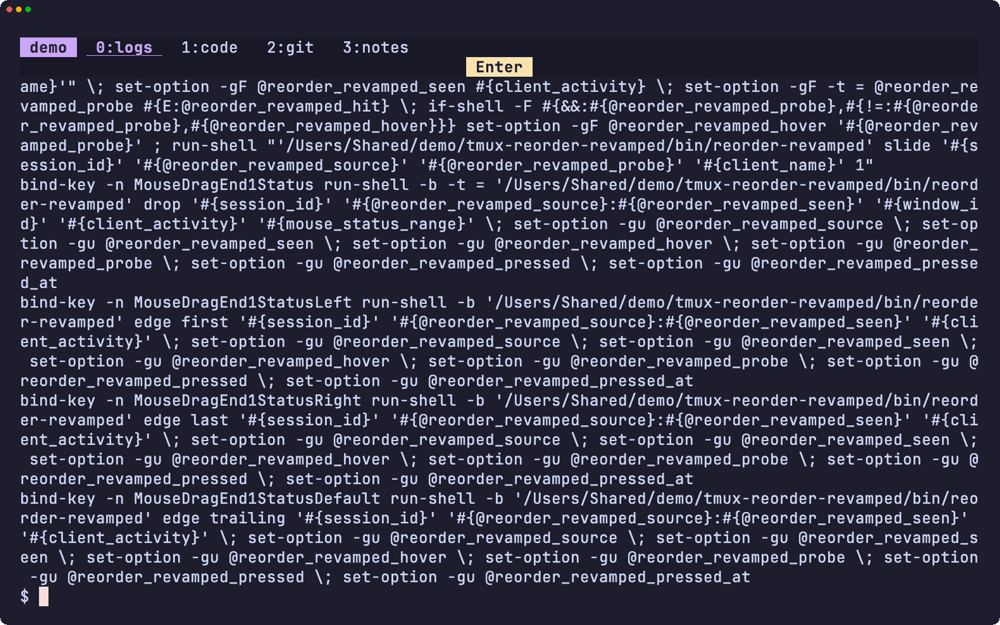<br><sub><code>list</code>，来自 <code>stills.tape</code></sub></td>
<td width="50%" valign="top">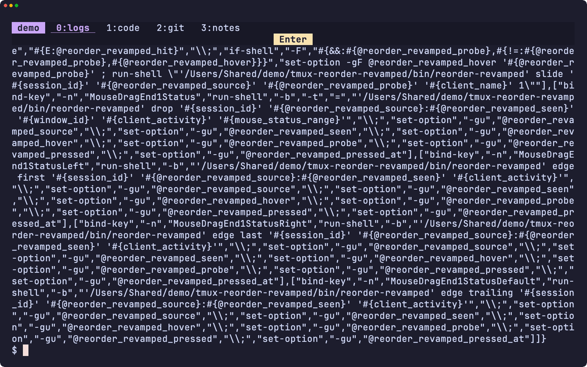<br><sub><code>list --json</code>，来自 <code>stills.tape</code></sub></td>
</tr>
<tr>
<td width="50%" valign="top">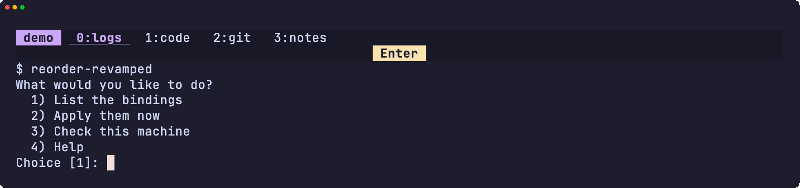<br><sub>没有 gum 的菜单，来自 <code>stills.tape</code></sub></td>
<td width="50%" valign="top">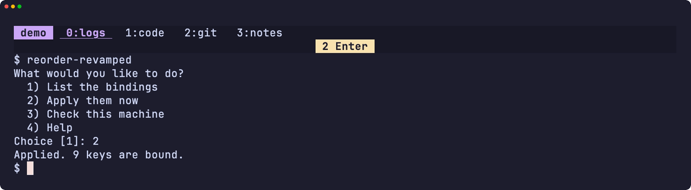<br><sub>从菜单运行 <code>apply</code>，来自 <code>stills.tape</code></sub></td>
</tr>
<tr>
<td width="50%" valign="top">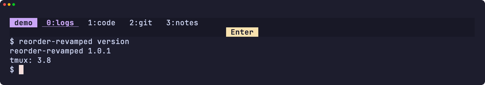<br><sub>版本，来自 <code>stills.tape</code></sub></td>
<td width="50%" valign="top">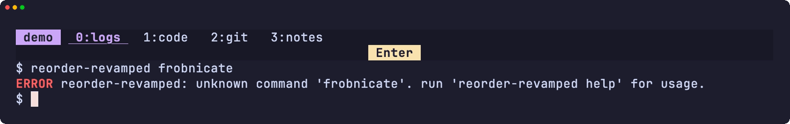<br><sub>未知命令，来自 <code>stills.tape</code></sub></td>
</tr>
<tr>
<td width="50%" valign="top">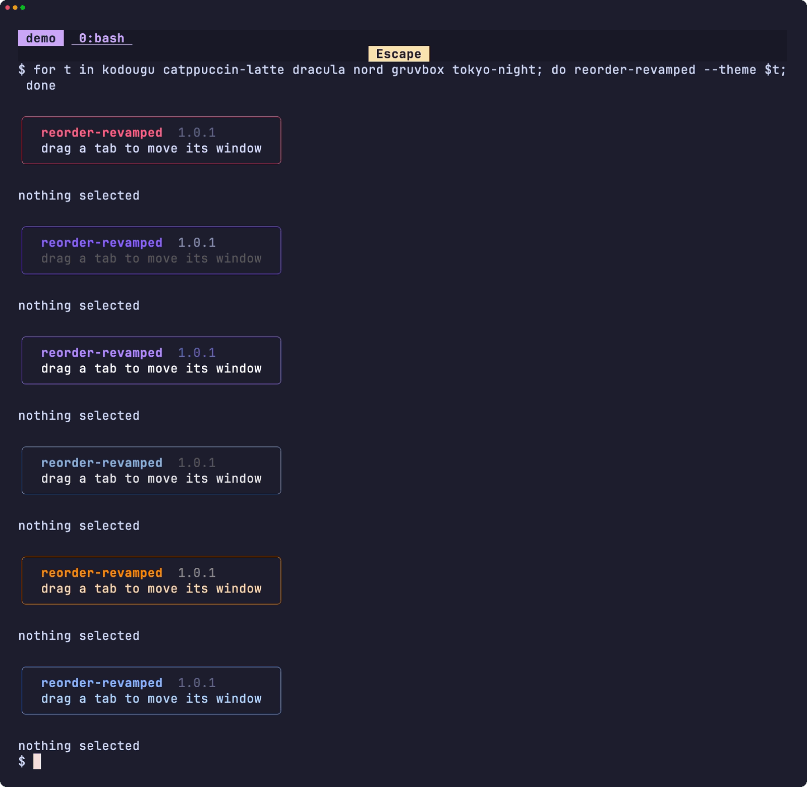<br><sub>六种主题下的标题，来自 <code>themes.tape</code></sub></td>
<td width="50%" valign="top">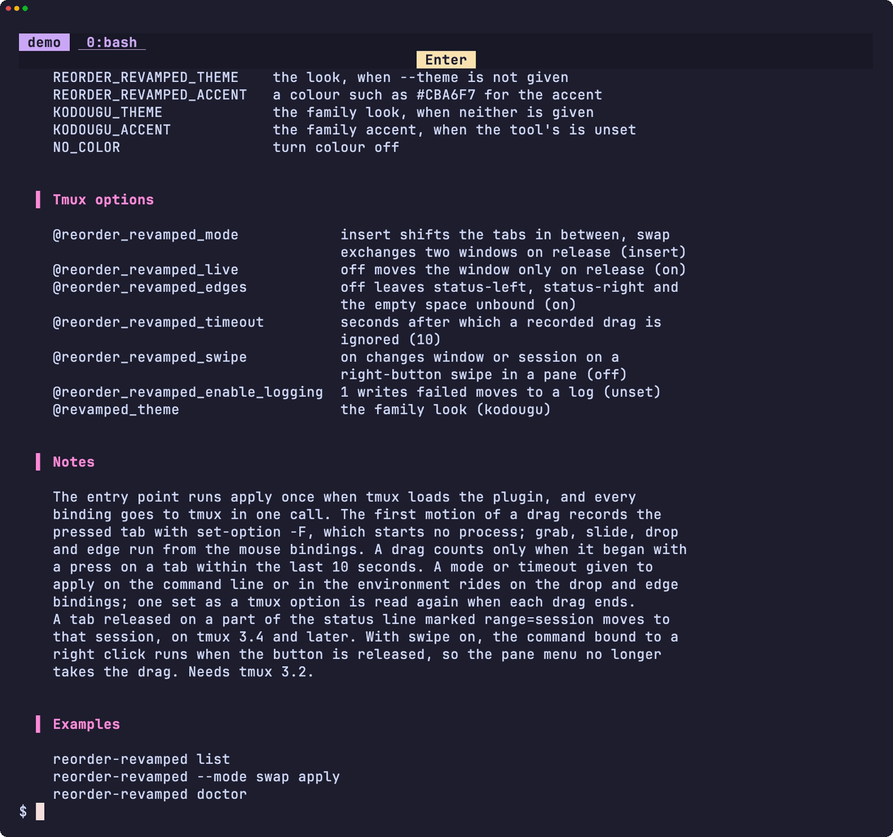<br><sub>帮助页，来自 <code>help.tape</code></sub></td>
</tr>
<tr>
<td width="50%" valign="top">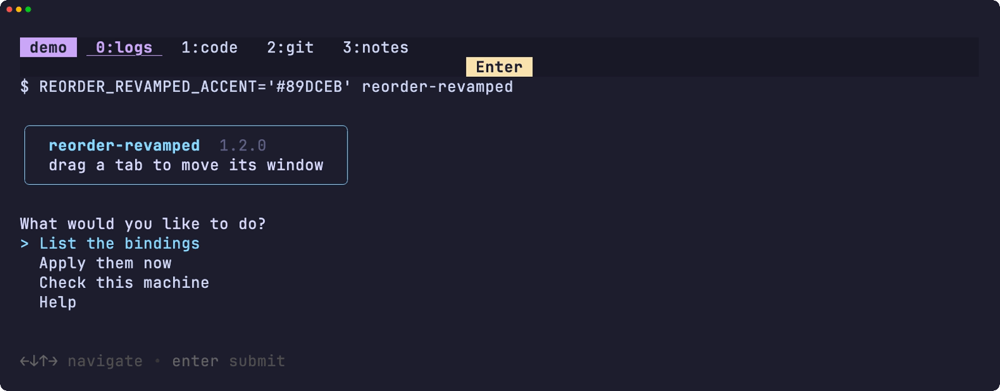<br><sub>来自 <code>REORDER_REVAMPED_ACCENT</code> 的强调色，来自 <code>stills.tape</code></sub></td>
<td width="50%" valign="top"></td>
</tr>
</table>

</details>

## 可移植性

插件是 POSIX `sh`。CI 在下面每一行上运行全部测试。

| Shell | 状态 |
|:------|:-------|
| `dash`、macOS 上的 `/bin/sh` | 支持 |
| `bash` 3.2 和 5.x、系统自带的 `zsh` 和 Homebrew 的 `zsh` | 支持 |

| 系统 | 状态 |
|:-------|:-------|
| macOS | Apple Silicon 和 Intel 上的 Tahoe，使用系统自带的工具、Homebrew 的 GNU 工具和 Homebrew 的 uutils |
| Linux | x86_64 和 arm64 上的 Ubuntu 26.04，使用 GNU coreutils、uutils 和 BusyBox |

## 开发

| 命令 | 运行内容 |
|:--------|:-------------|
| `make fmt` | 对每个脚本运行 shfmt `-i 2` |
| `make lint` | shfmt、ShellCheck、mandoc、yamllint 和 actionlint，零告警 |
| `make test` | 在系统 `sh` 下运行 bats 测试 |
| `make test-all` | 在每个已安装的 shell 下运行测试，macOS 上包括 bash 和 zsh 的两种构建 |
| `make test-linux` | 在 Ubuntu 容器中运行测试 |
| `make coverage` | 在这台 Mac 和 Ubuntu 容器中运行 bashcov，合并后以 100% 为门槛 |
| `make screens` | 用 VHS 在 tmux 中从真实插件录制上面的界面，在 macOS 上运行 |
| `make install` | 把命令、man 手册和补全安装到 `PREFIX` 下 |

提交遵循 Conventional Commits 格式，直接进入 `main`。`main` 上的 `ci` 通过后，`release.yml` 运行 semantic-release：自上一个标签以来的每个 `feat` 或 `fix` 都会发布新版本，更新版本常量，并把说明写进 [`CHANGELOG.md`](CHANGELOG.md)。

## 许可证

[MIT](LICENSE)，copyright Gustavo Franco。

<!-- family:begin -->

## tmux-revamped 插件家族

这个插件是 tmux-revamped 插件家族的一员。每个成员都带有 [`FAMILY.md`](FAMILY.md) 中相同的约定和相同的共享库，并且设计为一起安装：没有成员占用另一个成员占用的按键或 tmux 选项。

在一个成员中发现的缺陷，要在全部成员中排查之后才算修复完成。

| 成员 | 功能 |
|---|---|
| [`tmux-autoreload-revamped`](https://github.com/tmux-revamped/tmux-autoreload-revamped) | 编辑并保存 tmux 配置后，它会自动重新加载，无需按键，也无需命令 |
| [`tmux-battery-revamped`](https://github.com/tmux-revamped/tmux-battery-revamped) | 在 tmux 状态栏显示电池状态，从不阻塞状态栏渲染 |
| [`tmux-bluetooth-revamped`](https://github.com/tmux-revamped/tmux-bluetooth-revamped) | 在 tmux 状态栏显示每个已连接的蓝牙设备及其电量，不阻塞渲染 |
| [`tmux-cpu-revamped`](https://github.com/tmux-revamped/tmux-cpu-revamped) | 在 tmux 状态栏显示 CPU 负载、温度和频率，从不阻塞渲染 |
| [`tmux-disk-revamped`](https://github.com/tmux-revamped/tmux-disk-revamped) | 在 tmux 状态栏显示磁盘用量，从不阻塞状态栏渲染 |
| [`tmux-extract-revamped`](https://github.com/tmux-revamped/tmux-extract-revamped) | 用 fzf 从屏幕上挑选 URL、路径、哈希或任意其他词元，并输入到光标处，全部用纯 shell 实现 |
| [`tmux-fzf-revamped`](https://github.com/tmux-revamped/tmux-fzf-revamped) | 在弹出窗口中的 fzf 选择器里切换、关闭、重命名或创建 tmux 会话、窗口和窗格 |
| [`tmux-git-revamped`](https://github.com/tmux-revamped/tmux-git-revamped) | 在 tmux 状态栏中显示活动窗格的 git 分支、改动和托管平台计数，且不阻塞渲染 |
| [`tmux-gpu-revamped`](https://github.com/tmux-revamped/tmux-gpu-revamped) | 在 tmux 状态栏中显示 NVIDIA、AMD、Intel 和 Apple GPU 的负载、温度、频率、功耗和显存 |
| [`tmux-kube-revamped`](https://github.com/tmux-revamped/tmux-kube-revamped) | 在 tmux 状态栏中显示当前的 Kubernetes 上下文和命名空间，不依赖 kubectl，直接解析 kubeconfig |
| [`tmux-launcher-revamped`](https://github.com/tmux-revamped/tmux-launcher-revamped) | 在弹出窗口或新窗口中启动任意 TUI 应用，从当前窗格的目录开始，每个应用可配置一个按键 |
| [`tmux-logging-revamped`](https://github.com/tmux-revamped/tmux-logging-revamped) | 将任意窗格保存到文件：实时日志、完整回滚缓冲区或一次性截图 |
| [`tmux-music-revamped`](https://github.com/tmux-revamped/tmux-music-revamped) | 在 tmux 状态栏显示正在播放的曲目，从不阻塞状态栏渲染 |
| [`tmux-network-revamped`](https://github.com/tmux-revamped/tmux-network-revamped) | 在 tmux 状态栏显示网络吞吐量，从不阻塞渲染 |
| [`tmux-pain-control-revamped`](https://github.com/tmux-revamped/tmux-pain-control-revamped) | tmux 的窗格和窗口管理按键，适配 tmux 版本，兼容 vim，每个 prefix 按键都可禁用 |
| [`tmux-persist-revamped`](https://github.com/tmux-revamped/tmux-persist-revamped) | 保存 tmux 的所有会话、窗口和窗格，按定时器自动保存，并在重启后全部恢复 |
| [`tmux-plugin-template`](https://github.com/tmux-revamped/tmux-plugin-template) | tmux-revamped 插件的起点：共享库、bats 测试框架和 CI |
| [`tmux-pomodoro-revamped`](https://github.com/tmux-revamped/tmux-pomodoro-revamped) | tmux 状态栏中的番茄钟计时器，所有状态都保存在 tmux 选项中，不使用临时文件 |
| [`tmux-ram-revamped`](https://github.com/tmux-revamped/tmux-ram-revamped) | 在 tmux 状态栏显示内存、交换空间和内存压力，在后台采样，渲染从不等待 |
| [`tmux-reorder-revamped`](https://github.com/tmux-revamped/tmux-reorder-revamped) | **本插件**，用鼠标在 tmux 状态栏上拖动窗口标签来移动该窗口 |
| [`tmux-scroll-revamped`](https://github.com/tmux-revamped/tmux-scroll-revamped) | 将鼠标滚轮交给能自行滚动的应用，其他情况下进入 tmux 复制模式 |
| [`tmux-sensible-revamped`](https://github.com/tmux-revamped/tmux-sensible-revamped) | 按 tmux 版本和终端区分的合理默认设置，不改动你自己设置的选项 |
| [`tmux-tiling-revamped`](https://github.com/tmux-revamped/tmux-tiling-revamped) | tmux 的平铺窗口管理：八种布局，包括 BSP dwindle 和 spiral，并支持撤销布局 |
| [`tmux-time-revamped`](https://github.com/tmux-revamped/tmux-time-revamped) | 状态栏中的本地时钟和世界时钟，按一天中的时段着色，并提供倒计时和夏令时提醒 |
| [`tmux-weather-revamped`](https://github.com/tmux-revamped/tmux-weather-revamped) | 在后台从 wttr.in 获取天气并显示在状态栏，状态栏无需等待 |

<!-- family:end -->
